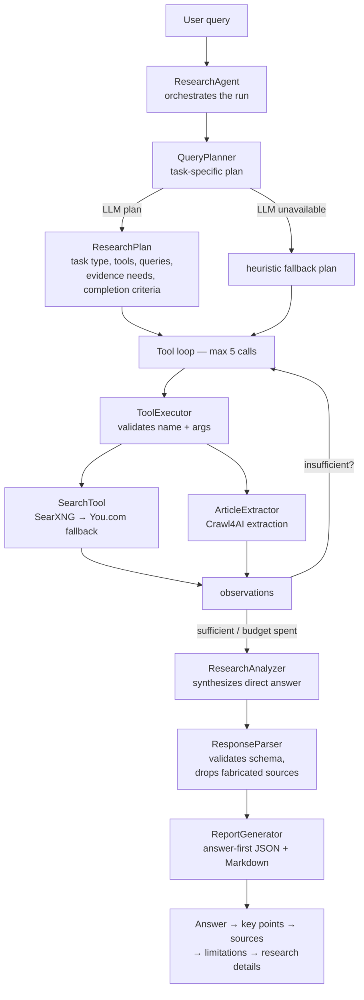

# FTSE 50 Market News Research Agent

An autonomous agentic research system that identifies the **top 50 FTSE companies
by market capitalisation**, finds their latest market-moving news, and produces
a structured **JSON + Markdown digest** — with evidence citations for every finding.

Built **base-first**: a reliable deterministic pipeline first, then the agentic
layer (Pydantic AI) on top. No LangGraph, no Tavily, no DuckDuckGo, no
over-engineered orchestration frameworks.

---

## Architecture

```
FTSE 100 (Wikipedia) ──► yfinance market caps ──► Top 50 by market cap
                                                        │
                                                        ▼
                                              ┌──────────────────┐
                                              │  Pydantic AI     │
                                              │  analysis agent  │
                                              └──────────────────┘
                                                        │ (one batched
                                                        │  call / company)
                                                        ▼
SearXNG ──► insufficient? ──► refined query ──► still insufficient? ──► You.com
(primary)                                                        (fallback, key required)
                                                        │
                                              + yfinance headlines
                                                        ▼
                                              URL dedup (canonicalisation)
                                                        ▼
                                              Source-quality ranking
                                              (deterministic tiers)
                                                        ▼
                                              Crawl4AI extraction
                                              (fallback: httpx + lxml;
                                               then snippet-only)
                                                        ▼
                                              Semantic dedup
                                              (all-MiniLM-L6-v2, cos > 0.85)
                                                        ▼
                                              Ollama LLM: impact / sentiment
                                              (Pydantic-validated output)
                                                        ▼
                                              Top 3 per company + evidence
                                                        ▼
                                              report_YYYY-MM-DD.json
                                              report_YYYY-MM-DD.md
                                                        ▼
                                              Pydantic Evals
```

### Why each technology

| Component | Choice | Why |
|---|---|---|
| Agent framework | **Pydantic AI** | Typed tools, structured/validated outputs, retry handling — Python-first, no graph DSL |
| FTSE list | Wikipedia + `pandas.read_html` | Free, no key; table detected by columns, not fixed index |
| Market caps | **yfinance** (`fast_info`) | Free; cached 7 days |
| Primary search | **SearXNG** (self-hosted) | Free, no per-query cost; `SEARXNG_BASE_URL` configurable |
| Fallback search | **You.com** | Used *only* when SearXNG is insufficient — never both per company |
| Supplementary news | `yfinance.Ticker.news` | Free extra headlines |
| Extraction | **Crawl4AI** | JS-heavy pages → clean Markdown; bounded retries + lightweight fallback |
| Dedup | **SentenceTransformers** `all-MiniLM-L6-v2` | Local, free; threshold configurable (default 0.85) |
| LLM analysis | **Ollama API** (paid key) | Financial-materiality reasoning; one batched call/company |
| Eval | **Pydantic Evals** | Repeatable scoring of relevance, impact, sentiment, dedup, fallbacks |
| Deps/env | **uv** | Fast, lockfile-based (`uv.lock` committed) |

### Design patterns implemented

1. **Parallel search/fetching** — per-company coroutines with bounded semaphores
   (search 4, crawl 3, LLM 2); never overwhelms providers.
2. **Source-quality ranking** — deterministic tiers (official/IR 1.0 → reputable
   0.8 → mainstream 0.6 → other 0.4 → low 0.15); explainable, never LLM-judged.
3. **URL/content deduplication** — canonical URL matching + embedding cosine filter.
4. **Evidence/citation tracking** — every finding keeps title, URL, source,
   publication date and a supporting excerpt.
5. **Caching** — companies, market caps, search results, extractions, LLM
   judgements (file-backed JSON, per-namespace TTLs, `data/cache/`).
6. **Fallback search/extraction** — SearXNG → refined → You.com; Crawl4AI →
   lightweight extractor → snippet-only; LLM failure → recorded, run continues.

The agent never does deterministic work: sorting, filtering, URL normalisation,
scoring and report rendering are plain Python. Pydantic AI is used where
reasoning/tool selection adds value — the financial-materiality analysis — plus
an opt-in fully agentic per-company mode (`--agentic`).

---

## Query-driven research agent

Query runs (`--query`, or the UI's research box) use a class-based agent core
in `agent/` instead of a fixed pipeline. The agent **answers the user's actual
question first** — search results are evidence, never the answer.



### Class responsibilities

| Class | File | Responsibility |
|---|---|---|
| `ResearchAgent` | `agent/research_agent.py` | Coordinates the lifecycle: plan → bounded tool loop → synthesize → validate → report; emits honest stage events |
| `QueryPlanner` | `agent/planner.py` | Interprets the query and generates a validated task-specific `ResearchPlan`; deterministic heuristic fallback when the LLM is down |
| `ToolRegistry` | `agent/tools.py` | The fixed set of permitted tools (`web_search`, `fetch_article`) with Pydantic arg schemas |
| `ToolExecutor` | `agent/tools.py` | Validates tool name/arguments, executes, suppresses duplicate calls; the model never touches the network |
| `SearchTool` | `agent/tools.py` | SearXNG primary, You.com fallback; drops unusable results, deprioritizes homepages, ranks by source quality + query-term overlap; per-query result cache |
| `ArticleExtractor` | `agent/tools.py` | Fetches and extracts one article URL via the existing Crawl4AI pipeline |
| `LLMClient` | `agent/llm_client.py` | Centralizes model calls: timeouts, bounded retries with exponential backoff, auth errors never retried, structured-output validation, run-scoped logging, no secrets in logs |
| `ResearchAnalyzer` | `agent/research_agent.py` | Synthesizes retrieved evidence into a direct, cited `QueryAnswer` |
| `ResponseParser` | `agent/research_agent.py` | Validates the answer: non-empty, sources ⊆ retrieved evidence (fabricated citations dropped), claim indices in range, confidence honest |
| `ReportGenerator` | `nodes/output.py` | `build_answer_report` / `render_answer_markdown`: Answer → key points → sources → confidence & limitations → research details (plan + tool trace) |

### Dynamic planning and tool calling

1. `QueryPlanner` classifies the intent (`factual_lookup`, `news_research`,
   `comparison`, `summarization`, `general`) and asks the LLM for a
   task-specific plan: which tools are allowed, which search queries to run,
   what evidence is needed, the expected answer format, and completion
   criteria. The plan is validated against the permitted tool set and the
   configurable call budget (`max_tool_calls`, default 5).
2. The agent executes planned searches/fetches, then lets the model request
   follow-up tool calls (`AgentStep`: `call_tool` or `finish`) until the
   evidence is sufficient or the budget is spent. Duplicate calls are skipped;
   disallowed tools stop the loop with a warning.
3. `ResearchAnalyzer` synthesizes the direct answer with inline citations;
   `ResponseParser` enforces schema and evidence integrity.

### Direct-answer and citation behaviour

- Every query report begins with an **Answer** section that resolves the
  question directly ("Georges Elhedery is the Group Chief Executive of HSBC
  Holdings plc." — not ten links).
- Sources appear beside the claims they support (`supports_claims` indices)
  and in a concise Sources section — only used sources, never the whole
  crawl set.
- For causal questions the agent distinguishes reported facts from
  speculation and never claims causation from date coincidence.
- If evidence is insufficient or conflicting, the report says the answer
  could not be verified (`verified: false`, confidence 0) instead of
  inventing one.
- Queries explicitly asking for detailed/ranked/comprehensive research
  (`plan.detailed`) additionally get ranked findings from the gathered
  evidence — still after the executive answer.

### Configuration

| Setting | Env | Default | Meaning |
|---|---|---|---|
| `max_tool_calls` | `MAX_TOOL_CALLS` | 5 | Hard bound on tool calls per query run |
| `llm_timeout_s` | `LLM_TIMEOUT_S` | 90 | Per-call model timeout |
| `llm_max_retries` | — | 3 | Bounded retries (auth failures never retried) |

API: `POST /api/research-runs` accepts `{"query": "...", "max_results": 20,
"time_range": "month"|"week"|"day"|"year", "fresh_search": true, "agentic": true}`.
`agentic` defaults to **true** for query runs (the research loop above);
pass `"agentic": false` for the legacy deterministic pipeline. For FTSE
company runs `agentic` keeps its original meaning (default false).

CLI: `--query "..." [--max-results N] [--time-range week] [--fresh] [--no-agent]`
(`--no-agent` selects the legacy deterministic query pipeline).

---

## Prerequisites

- Python 3.10+ and [uv](https://docs.astral.sh/uv/) (`curl -LsSf https://astral.sh/uv/install.sh | sh`)
- A SearXNG instance (see below) for live search
- Ollama paid API key + model for live LLM analysis
- Optional: You.com API key for the fallback path
- Optional: `crawl4ai-setup` (Playwright browsers) for full article extraction —
  the pipeline degrades gracefully to the lightweight extractor without it

---

## Setup

```bash
git clone <this-repo> && cd ftse50-news-agent
uv sync                      # install dependencies (+ dev: uv sync --group dev)
cp .env.example .env          # then fill in your keys (never commit .env)
```

### SearXNG (self-hosted, free)

```bash
docker compose -f docker-compose.searxng.yml up -d
# SEARXNG_BASE_URL=http://localhost:8080 in .env
```

Point `SEARXNG_BASE_URL` at any reachable instance — localhost is not assumed.

### Environment variables

| Variable | Required for | Notes |
|---|---|---|
| `OLLAMA_API_KEY` | live analysis | Paid key; never logged |
| `OLLAMA_BASE_URL` | live analysis | OpenAI-compatible endpoint, e.g. `https://ollama.com/v1` |
| `OLLAMA_MODEL` | live analysis | No hardcoded default — you choose the model |
| `SEARXNG_BASE_URL` | live search | Default `http://localhost:8080` |
| `YOU_API_KEY` | fallback search | Only used when SearXNG is insufficient |

---

## Running

```bash
uv run python main.py --mock                  # offline demo (no keys, no network)
uv run python main.py --limit-companies 5     # cheap live test
uv run python main.py --limit-companies 50    # full run
uv run python main.py --companies AZN.L,SHEL.L  # specific tickers (short EPICs OK)
uv run python main.py --agentic --limit-companies 2  # agent drives tools itself
uv run python main.py --no-cache              # bypass caches
uv run python main.py --evaluate              # Pydantic Evals suite
uv run pytest                                 # unit tests
```

Query-driven research (no company list needed):

```bash
uv run python main.py --query "Latest developments in semiconductor stocks"
uv run python main.py --query "Impact of interest rates on UK banks" \
    --max-results 10 --time-range week --fresh
```

`--query` runs the same search → extract → dedup → LLM pipeline driven by the
free-text query: query-aware SearXNG search (raw query first, then at most two
deterministic variants), topic-namespaced cache keys, one batched LLM call that
scores *relevance to the query* plus key findings, significance, impact and
confidence, and a `report_type: "query"` JSON + Markdown report. `--fresh`
bypasses cached search results for the query. Agentic mode is not supported
for `--query` runs.

Reports land in `data/output/report_YYYY-MM-DD.{json,md}` (a numeric suffix is
added instead of overwriting when a report for the same day already exists).

### Mock mode

`--mock` runs the full pipeline shape on bundled data
(`data/mock/mock_news.json`: 5 companies × 10 articles) with a deterministic
heuristic analyser — zero API cost, zero network. Use it to validate plumbing,
report rendering and the evaluation harness.

---

## Web UI + API

A dark financial-terminal-style dashboard (React 18 + TypeScript + Vite +
Tailwind, Recharts, Lucide) backed by a small FastAPI layer that drives the
**same** Python pipeline the CLI uses — no duplicated research logic.

Pages: **Overview** (research CTA, recent runs, latest query report or FTSE
digest with charts), **Research Runs** (query form with examples, fresh-search
toggle, advanced options, live SSE stage progress, run history), **Reports**
(library with query titles, search/filter/sort, JSON + Markdown downloads),
**Companies** (optional FTSE 50 reference directory), **Settings** (service
health and non-secret config status).

The primary experience is **query-driven research**: type any question or
topic on the Research Runs page and the agent searches the live web, extracts,
analyses and ranks — no FTSE company selection required. The legacy FTSE 50
company workflow remains available as a secondary mode.

```bash
# 1. Python API (from the repo root; uses the same uv environment and .env)
uv run uvicorn api.app:app --host 127.0.0.1 --port 8000
# or: uv run python -m api

# 2. Frontend (separate terminal)
cd web
npm install
npm run dev        # http://localhost:5173, /api proxied to :8000
```

Production frontend build: `cd web && npm run build` (outputs `web/dist/`).
Frontend tests / typecheck: `npm test`, `npm run typecheck`.
Backend tests: `uv run pytest` (includes `tests/test_api_*.py`).

Key API endpoints: `GET /api/health`, `GET /api/companies`,
`GET /api/reports`, `GET /api/reports/latest`, `GET /api/reports/{id}`,
`GET /api/reports/{id}/download?format=json|md`,
`POST /api/research-runs` (body: `{"query": "...", "max_results": 20,
"time_range": "month"|"week"|"day"|"year", "fresh_search": true}` for
query-driven research, or the legacy `{"tickers": [...], "limit_companies": N,
"agentic": bool, "no_cache": bool}` for FTSE company research),
`GET /api/research-runs`, `GET /api/research-runs/{id}`,
`GET /api/research-runs/{id}/events` (SSE), `POST /api/research-runs/{id}/cancel`,
`GET /api/settings/status`.

Notes:

- Only **one research run may be active at a time** (second `POST` → 409);
  cancelling keeps honest partial results. Run state is persisted under
  `data/cache/runs/` so a browser refresh never loses track of a run.
- Query runs stream honest pipeline stages over SSE
  (`search → extract → deduplicate → analyze → report`); legacy company runs
  stream per-company progress as before.
- Query search cache keys are namespaced by the normalized query plus time
  range and result limit — different queries never share cache entries.
  `fresh_search: true` bypasses cached search results for that run (the UI
  shows whether results came from cache).
- Live runs require `OLLAMA_API_KEY` (the API rejects run creation without
  it); tickers are validated against the backend's FTSE 50 list.
- The Settings page reports *whether* the LLM/search services are configured
  — API keys are never returned by any endpoint, logged, or stored in the
  browser. Configuration lives in the backend `.env`; the UI has no
  credential inputs. `VITE_API_BASE_URL` may point the frontend at another
  API origin (no secrets in `VITE_*` variables).
- CORS defaults to `http://localhost:5173` (+ 127.0.0.1); override with the
  `FRONTEND_ORIGINS` environment variable (comma-separated) for deployment.
- The UI is intended for local single-user use and has no login — do not
  expose the backend publicly without a security review.

---

## Cost-control strategy

- `--limit-companies` caps every run; `--mock` costs nothing.
- Search cascade never calls both providers per company; refined queries only
  when results are thin.
- Date filtering, URL dedup, semantic dedup and source ranking all happen
  **before** the LLM sees anything.
- One batched analysis call per company (not per article); concise prompts,
  short excerpts, structured short outputs.
- Caching at every stage; bounded retries with backoff; bounded concurrency.
- A single company's failure (search/extract/LLM) is recorded — it never aborts
  the 50-company run.

---

## Fallback behaviour

| Stage | Primary | On failure |
|---|---|---|
| Search | SearXNG | refined query → You.com (if key set) → continue with what exists |
| Supplementary | yfinance news | skipped silently, never fatal |
| Extraction | Crawl4AI | bounded retry → lightweight httpx/lxml extractor → snippet-only → marked `failed` |
| LLM | Ollama (Pydantic AI) | exponential backoff, ≤3 retries → company recorded as failed, run continues |

---

## Evaluation

`evaluation.py` + `eval_data/cases.json` implement the Pydantic Evals suite:

- impact classification · sentiment classification · duplicate detection
- source-quality ranking · structured-output validity
- missing/failed extraction handling · search-fallback cascade
- Ollama retry behaviour (transient → success; persistent → bounded give-up)

```bash
uv run python main.py --evaluate
```

Deterministic cases run locally with no keys. LLM-judged cases are skipped
unless `OLLAMA_*` is configured (reported, not faked). The dedup threshold
(0.85) ships with near-duplicate / distinct cases so it can be tuned objectively.

---

## Project structure

```
ftse50-news-agent/
├── main.py                 # CLI (uses nodes/runner.py orchestration)
├── api/                    # FastAPI backend for the web UI
│   ├── app.py              # app factory, CORS, lifespan
│   ├── schemas.py          # typed request/response models (no secrets)
│   ├── routes/             # health, companies, reports, runs, settings
│   └── services/           # report reading, run manager (SSE), health checks
├── web/                    # React 18 + TypeScript + Vite + Tailwind UI
│   └── src/
│       ├── components/     # design system (ui.tsx), layout, article dialog
│       ├── features/      # dashboard, runs, reports, companies, settings
│       └── lib/           # typed API client, formatters
├── config/settings.py      # validated, centralised configuration
├── agent/agent.py          # Pydantic AI agent + tools (pipeline & agentic modes)
├── agent/                  # query-driven research agent core
│   ├── research_agent.py   # ResearchAgent, ResearchAnalyzer, ResponseParser
│   ├── planner.py          # QueryPlanner + task classifier + fallback plans
│   ├── tools.py            # ToolRegistry, ToolExecutor, SearchTool, ArticleExtractor
│   └── llm_client.py       # LLMClient: timeouts, bounded retries, no secret leaks
├── nodes/
│   ├── ingestion.py        # FTSE 100 -> market caps -> top 50
│   ├── search.py           # SearXNG -> refined -> You.com + yfinance
│   ├── crawl.py            # Crawl4AI extraction + fallback
│   ├── deduplication.py    # URL + semantic dedup
│   ├── analysis.py         # Ollama analysis (Pydantic AI) + mock heuristic
│   ├── output.py           # JSON + Markdown reports
│   └── runner.py           # shared per-company orchestration (CLI + API)
├── utils/                  # models, cache, rate limiter, query builder, source quality
├── evaluation.py / eval_data/
├── tests/
├── data/mock/              # offline demo dataset
├── examples/               # sample reports
├── docker-compose.searxng.yml / searxng-settings.yml
└── pyproject.toml / uv.lock
```

---

## Limitations

- Live search quality depends on your SearXNG instance's engines.
- yfinance is rate-limited; market-cap fetch can be slow on first run (cached after).
- Article extraction needs Playwright browsers for Crawl4AI; without them the
  lightweight fallback is used (lower fidelity on JS-heavy pages).
- The paid Ollama key is billed per token — use `--limit-companies` / `--mock`
  while iterating. Agentic query runs make several model calls (plan + tool
  steps + synthesis); the tool budget bounds this, and simple factual queries
  typically finish in 1–2 calls.
- Dedup threshold 0.85 is a starting heuristic — tune with `--evaluate`.
- The agent has no live market-data tools: it cannot quote current prices or
  verify intraday moves beyond what retrieved articles report.
- Answer quality depends on retrieved evidence; with weak search results the
  agent returns an honest unverified answer rather than guessing.

## Future improvements

- Adaptive dedup threshold per sector; learned source-quality weights.
- Persistent vector store for cross-run dedup.
- Richer evals with human-labelled impact cases.
- Scheduled daily runs (cron) + diff-against-yesterday digest.
