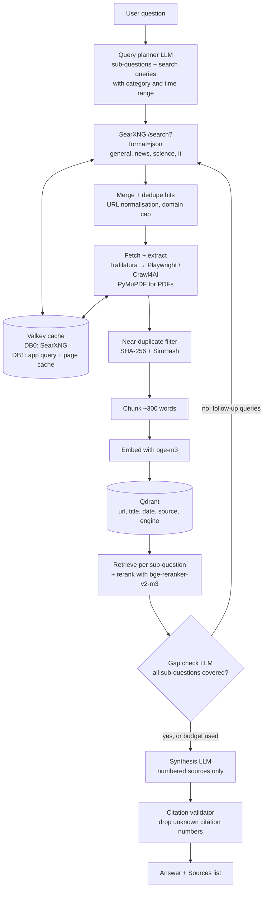

# Building a Research Agent on Self-Hosted SearXNG

**Developer guide for Ashok, Yantra3loka LLP (Mumbai)**
Version 1.0 · 11 October 2026

---

## 0. Read this first

**What you are building:** a research agent that takes a question, plans searches, runs them through our own SearXNG instance, reads the full pages (not just snippets), keeps the best passages, and writes an answer where every claim links back to a source.

**The hard rule:** we use only free, self-hostable tools. No paid APIs, no API keys for search, and no third-party rate limits that we depend on. Everything in this guide runs on our own machines:

| Job | Tool | Licence / cost |
|---|---|---|
| Meta-search | SearXNG | AGPL-3.0, free |
| Cache | Valkey (Redis-compatible) | BSD, free |
| Page extraction | Trafilatura, Playwright, Crawl4AI (optional), PyMuPDF | free (PyMuPDF is AGPL; fine for internal use) |
| Embeddings | BAAI/bge-m3 | MIT, runs locally |
| Reranker | BAAI/bge-reranker-v2-m3 | Apache-2.0, runs locally |
| Vector DB | Qdrant | Apache-2.0, free |
| LLM | Any open model served by Ollama, vLLM or llama.cpp | free, runs locally |

> Note on "no rate limits": SearXNG queries upstream engines such as Google, Bing and DuckDuckGo. Those engines can still block a busy IP. We cannot remove that, but we can make it rare with caching, engine redundancy, polite pacing and proxies (section 3). Scholarly engines that use official open APIs (arXiv, PubMed, Crossref, OpenAlex, Semantic Scholar) are much more stable.

**How this guide was checked:** every SearXNG setting below was checked against docs.searxng.org (docs build 2026.10.9) and the SearXNG source code. The `settings.yml` in section 2 was loaded into a real SearXNG instance, and the Python client was tested against it. Library calls were checked against current releases: sentence-transformers 6.1, qdrant-client 1.19, trafilatura 2.3, PyMuPDF 1.28, Crawl4AI 0.9, redis-py 8.1.

**Suggested repository layout:**

```text
research-stack/
├── docker-compose.yml
├── .env                      # secrets, never commit
├── searxng/
│   ├── settings.yml
│   └── limiter.toml          # only needed if you turn the limiter on
├── tor/Dockerfile            # optional
├── tools/
│   ├── engine_health.py
│   └── bulk_sources.py
└── app/
    ├── Dockerfile
    ├── requirements.txt
    └── research_agent/
        ├── config.py  models.py  urls.py  cache.py  searx_client.py
        ├── extract.py chunking.py models_ml.py store.py llm.py
        ├── prompts.py citations.py agent.py main.py cli.py
```

---

## 1. Architecture overview



**In plain words:**

1. **Plan.** The LLM splits the question into 2–5 sub-questions and writes search queries, each tagged with a category (`general`, `news`, `science`, `it`) and an optional time range.
2. **Search.** Queries go to SearXNG, which fans out to many engines at once and merges the results. Answers are cached in Valkey.
3. **Read.** We download the top pages, extract the main text (Trafilatura), fall back to a headless browser for JavaScript-heavy pages, and read PDFs with PyMuPDF.
4. **Clean.** Normalise URLs, drop duplicates and near-duplicates (for example, the same news wire story on 20 sites).
5. **Store.** Split text into chunks, embed with bge-m3, and store in Qdrant with metadata. The library grows with every run, so later research benefits from earlier work.
6. **Rank.** For each sub-question, pull candidate chunks from Qdrant, then rerank them with the cross-encoder. Only the best passages reach the LLM.
7. **Loop.** The LLM checks what is still missing and writes follow-up queries. We repeat until the question is covered or the round budget is used up.
8. **Write.** The LLM writes the answer using only numbered sources. Code then removes any citation number that does not exist.

---

## 2. SearXNG setup with Docker Compose

### 2.1 Get it running

The SearXNG project ships an official Compose template (`searxng-core` + `searxng-valkey`). We fold that into our own stack in section 11. To try SearXNG alone first:

```bash
mkdir -p research-stack/searxng && cd research-stack
openssl rand -hex 32            # copy the output into .env as SEARXNG_SECRET=...
# put settings.yml (below) into ./searxng/
docker compose up -d searxng valkey
curl -s 'http://localhost:8080/search?q=test&format=json' | head -c 400
```

Facts about the official image (`docker.io/searxng/searxng`):

- It listens on port **8080** inside the container.
- It reads config from **`/etc/searxng/`** (`settings.yml`, `limiter.toml`) and keeps persistent data in **`/var/cache/searxng/`**.
- Environment variables override settings: `SEARXNG_SECRET` → `server.secret_key`, `SEARXNG_BASE_URL` → `server.base_url`, `SEARXNG_LIMITER` → `server.limiter`, `SEARXNG_VALKEY_URL` → `valkey.url`.
- A GHCR mirror exists if Docker Hub rate-limits your image pulls.

### 2.2 `settings.yml` essentials

Use `use_default_settings: true` so you only write what you change. SearXNG merges your file with its built-in defaults, and merges the `engines:` list **by engine name**.

```yaml
# /etc/searxng/settings.yml  (mounted from ./searxng/settings.yml)
# Start from SearXNG's defaults and override only what we need.
use_default_settings: true

general:
  instance_name: "Yantra3loka Research"
  debug: false
  enable_metrics: true          # needed for /stats and /stats/errors
  open_metrics: ""              # set a password to enable Prometheus /metrics (basic auth)

server:
  # Generate with:  openssl rand -hex 32   (or set SEARXNG_SECRET in .env, which overrides this)
  secret_key: "CHANGE_ME_openssl_rand_hex_32"
  limiter: false                # private instance used only by our app; see section 2.4
  public_instance: false
  image_proxy: false
  method: "GET"

search:
  safe_search: 0
  autocomplete: ""              # no autocomplete calls for an API-only instance
  default_lang: "en"
  formats:
    - html                      # keep the web UI for debugging
    - json                      # REQUIRED for the agent; without it /search?format=json returns 403
  ban_time_on_fail: 5
  max_ban_time_on_fail: 120
  suspended_times:              # how long an engine is benched after these errors (seconds)
    SearxEngineAccessDenied: 3600
    SearxEngineCaptcha: 3600
    SearxEngineTooManyRequests: 900
    cf_SearxEngineCaptcha: 86400
    cf_SearxEngineAccessDenied: 86400
    recaptcha_SearxEngineCaptcha: 86400

valkey:
  url: valkey://valkey:6379/0   # DB 0 for SearXNG; the app uses DB 1

outgoing:
  request_timeout: 5.0          # default per-engine timeout (s)
  max_request_timeout: 15.0     # hard ceiling, even if an engine asks for more
  pool_connections: 100
  retries: 1                    # each retry uses another proxy / source IP if configured
  enable_http2: true
  useragent_suffix: ""          # optional contact info, e.g. "admin@yourdomain"
  # --- Option A: rotating HTTP/SOCKS proxies (round-robin) ---
  # proxies:
  #   all://:
  #     - http://proxy1:8080
  #     - socks5h://proxy2:1080
  # extra_proxy_timeout: 10
  # --- Option B: everything through Tor (see section 3.2) ---
  # proxies:
  #   all://:
  #     - socks5h://tor:9050
  # using_tor_proxy: true
  # extra_proxy_timeout: 10

plugins:
  searx.plugins.tracker_url_remover.SXNGPlugin:
    active: true
  searx.plugins.oa_doi_rewrite.SXNGPlugin:
    active: true                # rewrite paywalled DOI links to open-access copies when known

engines:
  # ---------- general ----------
  - name: duckduckgo
    disabled: false
  - name: brave
    disabled: false
  - name: google
    disabled: false             # off by default upstream; we enable it (blocks easily, keep redundancy)
  - name: bing
    disabled: false             # off by default upstream
  - name: wikipedia
    categories: [general, science]   # also answer background questions in "science"
  - name: wikidata
    disabled: false

  # ---------- news ----------
  - name: google news
    disabled: false
  - name: bing news
    disabled: false
  - name: duckduckgo news
    disabled: false
  - name: brave.news
    disabled: false
  - name: reuters
    disabled: false
  - name: wikinews
    disabled: false

  # ---------- science ----------
  - name: arxiv
    disabled: false
    weight: 1.5                 # boost scholarly sources in the merged ranking
  - name: google scholar
    disabled: false
    timeout: 8.0
    weight: 1.5
  - name: semantic scholar
    disabled: false
    weight: 1.5
  - name: pubmed
    disabled: false
    weight: 1.5
  - name: crossref
    disabled: false             # off by default upstream
    timeout: 10.0               # upstream default is 30s; keep it under max_request_timeout
  - name: openalex
    disabled: false             # off by default upstream; no API key needed
    mailto: "dev@example.com"   # replace: joins OpenAlex's "polite pool"
    weight: 1.5

  # ---------- it ----------
  - name: github
    disabled: false
  - name: stackoverflow
    disabled: false
  - name: askubuntu
    disabled: false
  - name: superuser
    disabled: false
  - name: mdn
    disabled: false
  - name: pypi
    disabled: false
  - name: docker hub
    disabled: false
  - name: hackernews
    disabled: false             # off by default upstream
  - name: huggingface
    disabled: false             # off by default upstream
```

What each important key does:

| Key | Why it matters |
|---|---|
| `use_default_settings: true` | Load all built-in engines and defaults, override only what we list. |
| `server.secret_key` | Used for cryptography. SearXNG exits at startup if it is still the stock `ultrasecretkey`. Our file has another placeholder, so **always set `SEARXNG_SECRET` in `.env`** (it overrides the file) or paste a random key. |
| `server.limiter: false` | The limiter is SearXNG's bot protection and per-IP rate limit. Our app is the only client, so we turn it off. Otherwise it would rate-limit our own agent. |
| `server.public_instance: false` | Turning it on enables features meant for public sites (link token, image proxy). Not needed. |
| `search.formats` | **Must include `json`.** If it is missing, `/search?format=json` returns **403 Forbidden**. |
| `search.suspended_times` | How long an engine is benched after a CAPTCHA, 403 or 429. Shorter values retry sooner but risk longer upstream bans. |
| `valkey.url` | Valkey connection. Used by the limiter and SearXNG internals. The old `redis:` key is deprecated: use `valkey:`. |
| `outgoing.*` | Timeouts, retries, proxies, Tor (section 3). |
| `engines[].disabled` | `true` = off by default, but still callable explicitly (see 2.3). |
| `engines[].inactive` | `true` = not loaded at all. Engines that need an API key are `inactive` by default. We leave those alone (paid or keyed). |
| `engines[].weight` | Multiplies an engine's results in the merged ranking. We boost scholarly engines. |
| `engines[].timeout` | Per-engine timeout. It is capped by `outgoing.max_request_timeout`. |

**Engines we enable by category** (all free, no keys):

| Category | Engines (shortcut) | Notes |
|---|---|---|
| general | duckduckgo (`ddg`), brave (`br`), google (`go`), bing (`bi`), wikipedia (`wp`), wikidata (`wd`) | Google and Bing are disabled by default upstream; we enable them for redundancy. Wikipedia answers mostly come back as **infoboxes**, not results. |
| news | google news (`gon`), bing news (`bin`), duckduckgo news (`ddn`), brave.news (`brnews`), reuters (`reu`), wikinews (`wn`) | Use `time_range` for recency. |
| science | arxiv (`arx`), google scholar (`gos`), semantic scholar (`se`), pubmed (`pub`), crossref (`cr`), openalex (`oa`), plus wikipedia (we added `science` to its categories) | Crossref and OpenAlex are disabled by default upstream; we enable them. OpenAlex needs no key; `mailto` is optional but recommended. |
| it | github (`gh`), stackoverflow (`st`), askubuntu (`ubuntu`), superuser (`su`), mdn (`mdn`), pypi (`pypi`), docker hub (`dh`), hackernews (`hn`), huggingface (`hf`) | `it` can return hundreds of package hits; the client caps results per query. |

> Engines we do **not** enable: `startpage` and `mojeek` are marked `inactive` upstream (mojeek uses a heavy proof-of-work CAPTCHA). `core.ac.uk` and `springer nature` need API keys. Skip them.

**What we saw in testing (from a datacenter IP, no proxy):** duckduckgo, bing, bing news, duckduckgo news, arxiv, semantic scholar, pubmed, crossref, openalex, github and stackoverflow all returned results. Google, Google News and Google Scholar returned "access denied", Brave returned "too many requests", and Reuters returned HTTP 401. **That is exactly why redundancy matters:** never depend on one engine. Run the health check in section 12 on our own server and adjust.

### 2.3 Categories, engines and `!bang` shortcuts in API queries

The Search API is `GET /search` (or `POST`) with these parameters:

| Parameter | Values | Notes |
|---|---|---|
| `q` | text | Required. Passed to engines, so engine-specific syntax such as `site:` works where supported. |
| `format` | `json`, `csv`, `rss` | Must be listed in `search.formats`. |
| `categories` | comma list, e.g. `science,news` | Runs every enabled engine in those categories. |
| `engines` | comma list, e.g. `arxiv,pubmed` | Runs exactly these engines, **even if `disabled: true`**. Not listed in the API doc table, but supported by the code (`searx/webadapter.py`). |
| `language` | e.g. `en`, `en-IN`, `all` | |
| `pageno` | 1, 2, … | |
| `time_range` | `day`, `week`, `month`, `year` | Only engines that support it apply it. |
| `safesearch` | `0`, `1`, `2` | |

**Bangs** go inside `q` and select engines or categories:

- `!arx retrieval augmented generation`: arXiv only (engine shortcut).
- `!science graph neural networks`: every engine in the science category.
- `!arx !pub crispr base editing`: arXiv **and** PubMed (bangs chain and add up).
- Category names with spaces use underscores: `!scientific_publications`.
- `:en !wp transformer`: language prefix plus engine.
- `!!` (double bang) jumps to an **external** DuckDuckGo bang page. Never use it in the agent.

In testing, a bang in `q` took priority over the `categories` parameter. For the agent, prefer the explicit `engines=` / `categories=` parameters: they are easier to log and test than bangs inside query text.

```bash
# Science category, last year
curl -s 'http://localhost:8080/search?q=rag+evaluation&format=json&categories=science&time_range=year'
# Exact engines
curl -s 'http://localhost:8080/search?q=rag+evaluation&format=json&engines=arxiv,semantic%20scholar,openalex'
# Bang form
curl -s 'http://localhost:8080/search?format=json&q=!arx%20!pub%20crispr'
```

**JSON response shape** (fields you will use):

```json
{
  "query": "rag evaluation",
  "results": [
    {"url": "...", "title": "...", "content": "snippet", "engine": "arxiv",
     "engines": ["arxiv", "semantic scholar"], "score": 2.5, "category": "science",
     "publishedDate": "2025-06-08T01:33:05"}
  ],
  "answers": [], "corrections": [], "infoboxes": [], "suggestions": [],
  "unresponsive_engines": [["google scholar", "access denied"]]
}
```

`score` already rewards results that several engines agree on. `unresponsive_engines` tells you which engines failed for this query; log it.

### 2.4 Bot detection and the limiter

The limiter protects **public** instances: it checks HTTP headers, keeps IP block and pass lists, and rate-limits by behaviour. It needs Valkey and correct `X-Forwarded-For` / `X-Real-IP` headers from a reverse proxy.

For our private, internal instance, **keep `limiter: false`**. If you later open the UI to colleagues and turn it on, add `searxng/limiter.toml` so the agent's Docker network is never limited (the `pass_ip` list has priority over all other checks):

```toml
# Only used if you set server.limiter: true (e.g. when other teams/people also use the UI).
# Docker networks are passed through so the agent itself is never rate-limited.

[botdetection]
ipv4_prefix = 32
ipv6_prefix = 48
trusted_proxies = [
  '127.0.0.0/8',
  '::1',
  '172.16.0.0/12',   # docker bridge networks (e.g. a reverse proxy container in front of SearXNG)
]

[botdetection.ip_limit]
link_token = false

[botdetection.ip_lists]
pass_ip = [
  '172.16.0.0/12',   # the app container
  '10.0.0.0/8',
]
```

> Don't copy SearXNG's whole default `limiter.toml`. Override only what you need, as above.

---

## 3. Avoiding upstream blocks

Upstream engines block IPs that send too many automated queries. Our defences, in order of value:

1. **Cache aggressively** (section 4). Repeated queries never hit upstream.
2. **Engine redundancy.** Several engines per category, so a CAPTCHA on one engine does not hurt. SearXNG benches failing engines automatically (`suspended_times`).
3. **Polite pacing.** The app limits concurrent searches (`SEARCH_CONCURRENCY=3`) and does not repeat queries within a run.
4. **Spread the egress IPs:** multiple source IPs, proxies you control, or Tor.

### 3.1 Timeouts and retries

```yaml
outgoing:
  request_timeout: 5.0       # default timeout per engine (seconds)
  max_request_timeout: 15.0  # ceiling, even if an engine sets a larger timeout
  retries: 1                 # retry on HTTP error; each retry uses another proxy/source IP
  pool_connections: 100
```

Per engine: `timeout: 8.0` (slow scholarly engines), `retry_on_http_error: [429]`, `max_connections`. Keep timeouts short. A slow engine delays the whole response, because SearXNG waits for engines until the timeout.

### 3.2 Proxies and Tor

**Option A: proxies you run or control** (round-robin across the list):

```yaml
outgoing:
  proxies:
    all://:
      - http://proxy1:8080
      - socks5h://proxy2:1080
  extra_proxy_timeout: 10     # extra seconds to allow for proxy latency
```

Supported schemes: `http://`, `https://`, `socks4://`, `socks5://`, `socks5h://`. Free options that stay within our rules: a few cheap VMs we already have running Squid or Dante, or SSH SOCKS tunnels (`ssh -D`). Avoid public "free proxy lists": they are unreliable and unsafe.

**Option B: multiple source IPs.** If our server has several IPv4 addresses or an IPv6 range, SearXNG can rotate the outgoing address:

```yaml
outgoing:
  source_ips:
    - 192.168.0.1
    - 192.168.0.2
    # or an IPv6 range, e.g. - fe80::60a2:1691:e5a2:ee1f/126
```

**Option C: Tor (free).** Start the optional `tor` service (`docker compose --profile tor up -d tor`, Dockerfile in section 11), then:

```yaml
outgoing:
  proxies:
    all://:
      - socks5h://tor:9050    # must be socks5h:// so DNS goes through Tor
  using_tor_proxy: true
  extra_proxy_timeout: 10
```

When `using_tor_proxy` is on, SearXNG checks `https://check.torproject.org/api/ip` and refuses to use proxies that are not Tor; every proxy URL must start with `socks5h://`.

**Be realistic about Tor:** Google, Bing and Google Scholar block most Tor exit nodes. Routing everything through Tor often makes things worse. A better pattern is to route only selected engines through Tor and leave the rest direct:

```yaml
engines:
  - name: duckduckgo
    using_tor_proxy: true
    proxies:
      all://:
        - socks5h://tor:9050
```

### 3.3 Polite rates

- Keep the app's `SEARCH_CONCURRENCY` at 2–4 and `QUERIES_PER_ROUND` at about 5.
- Never run load tests against the live SearXNG. Use cached queries or a mock.
- Put contact info in `outgoing.useragent_suffix` (for example an admin email). Some engines are more tolerant when they can identify you.
- Schedule bulk jobs (section 9) at night and away from interactive use.
- For page fetching, the app enforces one request per host every `PER_HOST_DELAY` seconds (default 1.5) and respects `robots.txt`.

---

## 4. Caching with Valkey

Two layers, one Valkey server:

| Layer | Where | What | TTL |
|---|---|---|---|
| SearXNG internal | `valkey.url: valkey://valkey:6379/0` | limiter state, internal data | managed by SearXNG |
| App query cache | `redis://valkey:6379/1`, key `sx:<sha256(params)>` | raw SearXNG JSON per (q, categories/engines, time_range, page, language) | 6 h general/science, 15 min news or `time_range=day` |
| App page cache | DB 1, key `page:<sha256(canonical_url)>` | extracted title, text, date, type | 7 days |
| Negative cache | DB 1, key `neg:<sha256(url)>` | URLs that failed to fetch | 6 h |

Notes:

- SearXNG does **not** cache search results for you. The `valkey` setting does not give you a result cache, so the app-level cache is what saves upstream calls.
- Do **not** cache empty result sets. Empty results usually mean a temporary block, and caching them would hide the recovery.
- Valkey is started with `--maxmemory 1gb --maxmemory-policy volatile-lru`, so when memory fills up, only keys with a TTL are evicted.
- redis-py talks to Valkey unchanged (same protocol); the URL scheme `redis://` is fine for the app. SearXNG itself expects `valkey://`.

```python
from __future__ import annotations

import hashlib
import json
from typing import Any

import redis.asyncio as redis  # redis-py speaks the same protocol as Valkey


class Cache:
    """App-level cache on Valkey (separate DB from SearXNG's own DB 0).

    Keys:
      sx:<sha256>   -> SearXNG JSON response for (query, categories, engines, time_range, page, lang)
      page:<sha256> -> extracted document (title/text/date) for a canonical URL
      neg:<sha256>  -> negative cache: URL failed to fetch/extract recently
    """

    def __init__(self, url: str) -> None:
        self._r = redis.from_url(url, decode_responses=True)

    @staticmethod
    def key(prefix: str, payload: dict[str, Any] | str) -> str:
        raw = payload if isinstance(payload, str) else json.dumps(payload, sort_keys=True, ensure_ascii=False)
        return f"{prefix}:{hashlib.sha256(raw.encode('utf-8')).hexdigest()}"

    async def get_json(self, key: str) -> Any | None:
        raw = await self._r.get(key)
        return json.loads(raw) if raw else None

    async def set_json(self, key: str, value: Any, ttl: int) -> None:
        await self._r.set(key, json.dumps(value, ensure_ascii=False), ex=ttl)

    async def mark_failed(self, url: str, ttl: int = 6 * 3600) -> None:
        await self._r.set(self.key("neg", url), "1", ex=ttl)

    async def recently_failed(self, url: str) -> bool:
        return bool(await self._r.exists(self.key("neg", url)))

    async def ping(self) -> bool:
        return bool(await self._r.ping())

    async def close(self) -> None:
        await self._r.aclose()
```

---

## 5. Full-text extraction

**Pipeline per URL:**

1. **Cache check** (page cache, negative cache).
2. **SSRF guard.** Search results are untrusted input. Never fetch private or loopback addresses: a malicious result could otherwise reach Valkey, Qdrant or our LAN. The guard runs on every redirect hop too.
3. **robots.txt** check and **per-host throttle**.
4. **Download** with a size cap (20 MB).
5. **PDF?** (content type, `.pdf`, or `%PDF-` magic bytes) → **PyMuPDF**.
6. **HTML** → **Trafilatura** (`output_format="json"`, `with_metadata=True`, so we get title and date).
7. If the text is shorter than about 600 characters, the page probably needs JavaScript → **Crawl4AI** if installed, otherwise **Playwright** plus Trafilatura on the rendered HTML. Browser use is limited to 2 at a time.
8. **Dedup:** exact (SHA-256 of normalised text) and near-duplicate (64-bit SimHash, Hamming distance ≤ 3).

### 5.1 URL normalisation and dedup

Normalisation gives one key per page: lowercase host, drop `www.`, default ports and `#fragments`; remove tracking parameters (`utm_*`, `fbclid`, `gclid`, …); sort query parameters; map arXiv `/pdf/…v3.pdf` and `/abs/…v2` to `https://arxiv.org/abs/<id>`; lowercase DOIs.

```python
from __future__ import annotations

import hashlib
import re
from urllib.parse import parse_qsl, urlencode, urlsplit, urlunsplit

TRACKING_PARAMS = {
    "fbclid", "gclid", "dclid", "msclkid", "mc_cid", "mc_eid", "igshid", "yclid",
    "ref", "ref_src", "ref_url", "spm", "_hsenc", "_hsmi", "cmpid", "ito",
}
TRACKING_PREFIXES = ("utm_", "pk_", "mtm_", "ga_")
DEFAULT_PORTS = {"http": "80", "https": "443"}
ARXIV_RE = re.compile(r"^/(abs|pdf)/(?P<id>[0-9]{4}\.[0-9]{4,5}|[a-z\-]+(\.[A-Z]{2})?/[0-9]{7})(v[0-9]+)?(\.pdf)?$")


def normalize_url(url: str) -> str:
    """Canonical form used for dedup and as the cache/vector key.

    - lowercases scheme and host, drops "www.", default ports and fragments
    - removes tracking parameters and sorts the rest
    - removes trailing slash (except root)
    - maps arXiv /pdf/ and versioned links to https://arxiv.org/abs/<id>
    - maps doi.org variants to https://doi.org/<lowercase doi>
    """
    parts = urlsplit(url.strip())
    scheme = (parts.scheme or "https").lower()
    host = (parts.hostname or "").lower()
    if host.startswith("www."):
        host = host[4:]
    port = f":{parts.port}" if parts.port and str(parts.port) != DEFAULT_PORTS.get(scheme) else ""
    path = re.sub(r"/{2,}", "/", parts.path or "/")

    if host in {"arxiv.org", "export.arxiv.org"}:
        m = ARXIV_RE.match(path)
        if m:
            return f"https://arxiv.org/abs/{m.group('id')}"
    if host in {"doi.org", "dx.doi.org"}:
        return f"https://doi.org/{path.lstrip('/').lower()}"

    if len(path) > 1 and path.endswith("/"):
        path = path[:-1]
    query = [
        (k, v)
        for k, v in parse_qsl(parts.query, keep_blank_values=False)
        if k.lower() not in TRACKING_PARAMS and not k.lower().startswith(TRACKING_PREFIXES)
    ]
    query.sort()
    return urlunsplit((scheme, host + port, path, urlencode(query), ""))


def hostname(url: str) -> str:
    host = (urlsplit(url).hostname or "").lower()
    return host[4:] if host.startswith("www.") else host


def content_hash(text: str) -> str:
    """Exact-duplicate fingerprint on whitespace/case-normalised text."""
    norm = re.sub(r"\s+", " ", text).strip().lower()
    return hashlib.sha256(norm.encode("utf-8")).hexdigest()


def simhash(text: str, bits: int = 64) -> int:
    """64-bit SimHash over word 3-shingles, for near-duplicate detection (syndicated news, mirrors)."""
    words = re.findall(r"\w+", text.lower())
    shingles = [" ".join(words[i : i + 3]) for i in range(max(1, len(words) - 2))]
    vector = [0] * bits
    for sh in shingles:
        h = int.from_bytes(hashlib.blake2b(sh.encode("utf-8"), digest_size=8).digest(), "big")
        for i in range(bits):
            vector[i] += 1 if (h >> i) & 1 else -1
    return sum(1 << i for i in range(bits) if vector[i] > 0)


def hamming(a: int, b: int) -> int:
    return bin(a ^ b).count("1")


class Deduper:
    """Tracks canonical URLs, exact hashes and simhashes seen during one research run."""

    def __init__(self, near_dup_threshold: int = 3) -> None:
        self.urls: set[str] = set()
        self.hashes: set[str] = set()
        self.simhashes: list[int] = []
        self.threshold = near_dup_threshold

    def seen_url(self, canonical_url: str) -> bool:
        return canonical_url in self.urls

    def add_url(self, canonical_url: str) -> None:
        self.urls.add(canonical_url)

    def is_duplicate_text(self, text: str) -> bool:
        h = content_hash(text)
        if h in self.hashes:
            return True
        sh = simhash(text)
        if any(hamming(sh, other) <= self.threshold for other in self.simhashes):
            return True
        self.hashes.add(h)
        self.simhashes.append(sh)
        return False
```

### 5.2 Extractor

```python
from __future__ import annotations

import asyncio
import ipaddress
import json
import os
import socket
import logging
import time
from collections import defaultdict
from typing import Any
from urllib.parse import urlsplit
from urllib.robotparser import RobotFileParser

import httpx
import pymupdf  # PyMuPDF >= 1.24 ("import fitz" is the legacy name)
import trafilatura

from .cache import Cache
from .models import Document, SearchHit
from .urls import content_hash, hostname

log = logging.getLogger(__name__)

MAX_BYTES = 20 * 1024 * 1024  # skip anything larger than 20 MB
MIN_TEXT_CHARS = 600  # below this, assume the page needs JavaScript and try the browser fallback


# Some networks resolve every name to a "fake IP" (e.g. 198.18.0.0/15 behind a transparent proxy).
# List such ranges, comma-separated, in FETCH_ALLOWED_NETS so the SSRF guard does not block everything.
ALLOWED_NETS = [ipaddress.ip_network(n.strip()) for n in os.getenv("FETCH_ALLOWED_NETS", "").split(",") if n.strip()]


class BlockedURL(httpx.RequestError):
    pass


async def is_public_host(host: str) -> bool:
    """SSRF guard: search results are untrusted, so never fetch private, loopback or link-local addresses
    (that would let a malicious result reach Valkey, Qdrant or your LAN)."""
    try:
        infos = await asyncio.to_thread(socket.getaddrinfo, host, None)
    except socket.gaierror:
        return False
    for info in infos:
        ip = ipaddress.ip_address(info[4][0])
        if not ip.is_global and not any(ip in net for net in ALLOWED_NETS):
            return False
    return True


async def _guard_request(request: httpx.Request) -> None:
    # httpx calls request hooks for every hop, so redirects to internal hosts are blocked too.
    if request.url.scheme not in ("http", "https") or not await is_public_host(request.url.host):
        raise BlockedURL(f"blocked non-public URL: {request.url}", request=request)


class HostThrottle:
    """At most one request per host every `delay` seconds (polite crawling)."""

    def __init__(self, delay: float) -> None:
        self.delay = delay
        self._locks: dict[str, asyncio.Lock] = defaultdict(asyncio.Lock)
        self._last: dict[str, float] = {}

    async def wait(self, host: str) -> None:
        async with self._locks[host]:
            elapsed = time.monotonic() - self._last.get(host, 0.0)
            if elapsed < self.delay:
                await asyncio.sleep(self.delay - elapsed)
            self._last[host] = time.monotonic()


class Robots:
    """Caches robots.txt per host and answers can_fetch()."""

    def __init__(self, http: httpx.AsyncClient, user_agent: str) -> None:
        self._http = http
        self._ua = user_agent
        self._parsers: dict[str, RobotFileParser | None] = {}

    async def allowed(self, url: str) -> bool:
        parts = urlsplit(url)
        base = f"{parts.scheme}://{parts.netloc}"
        if base not in self._parsers:
            try:
                resp = await self._http.get(f"{base}/robots.txt", timeout=8.0)
                if resp.status_code >= 400:
                    self._parsers[base] = None  # no robots.txt -> allowed
                else:
                    rp = RobotFileParser()
                    rp.parse(resp.text.splitlines())
                    self._parsers[base] = rp
            except httpx.HTTPError:
                self._parsers[base] = None
        rp = self._parsers[base]
        return True if rp is None else rp.can_fetch(self._ua, url)


def _trafilatura_extract(html: str, url: str) -> dict[str, Any] | None:
    out = trafilatura.extract(
        html,
        url=url,
        output_format="json",
        with_metadata=True,
        include_comments=False,
        include_tables=True,
        favor_recall=True,
    )
    return json.loads(out) if out else None


def _pdf_extract(data: bytes) -> tuple[str, str, str | None]:
    """Returns (title, text, date) from PDF bytes."""
    with pymupdf.open(stream=data, filetype="pdf") as doc:
        meta = doc.metadata or {}
        pages = [page.get_text("text", sort=True) for page in doc]
    text = "\n\n".join(p.strip() for p in pages if p.strip())
    raw_date = meta.get("creationDate") or ""  # e.g. "D:20240115093000Z"
    date = f"{raw_date[2:6]}-{raw_date[6:8]}-{raw_date[8:10]}" if raw_date.startswith("D:") and len(raw_date) >= 10 else None
    return (meta.get("title") or "").strip(), text, date


async def _render_with_browser(url: str) -> str | None:
    """JS fallback. Prefers Crawl4AI (gives clean markdown), else plain Playwright + Trafilatura."""
    try:
        from crawl4ai import AsyncWebCrawler, BrowserConfig, CacheMode, CrawlerRunConfig

        async with AsyncWebCrawler(config=BrowserConfig(headless=True, verbose=False)) as crawler:
            result = await crawler.arun(
                url=url,
                config=CrawlerRunConfig(cache_mode=CacheMode.BYPASS, remove_overlay_elements=True,
                                        page_timeout=30000),
            )
            if result.success and result.markdown:
                return str(result.markdown.raw_markdown)
            return None
    except ImportError:
        pass

    from playwright.async_api import async_playwright

    async with async_playwright() as p:
        browser = await p.chromium.launch(headless=True)
        try:
            page = await browser.new_page()
            await page.goto(url, wait_until="networkidle", timeout=30000)
            html = await page.content()
        finally:
            await browser.close()
    data = await asyncio.to_thread(_trafilatura_extract, html, url)
    return data.get("text") if data else None


class Extractor:
    def __init__(
        self,
        cache: Cache,
        *,
        user_agent: str,
        per_host_delay: float = 1.5,
        concurrency: int = 6,
        page_ttl: int = 7 * 24 * 3600,
        browser_fallback: bool = True,
    ) -> None:
        self._http = httpx.AsyncClient(
            follow_redirects=True,
            timeout=httpx.Timeout(20.0, connect=8.0),
            headers={"User-Agent": user_agent, "Accept-Language": "en;q=0.9,*;q=0.5"},
            limits=httpx.Limits(max_connections=concurrency * 2),
            event_hooks={"request": [_guard_request]},
        )
        self._cache = cache
        self._throttle = HostThrottle(per_host_delay)
        self._robots = Robots(self._http, user_agent)
        self._sem = asyncio.Semaphore(concurrency)
        self._browser_sem = asyncio.Semaphore(2)  # headless browsers are heavy
        self._page_ttl = page_ttl
        self._browser_fallback = browser_fallback

    async def close(self) -> None:
        await self._http.aclose()

    async def fetch(self, hit: SearchHit) -> Document | None:
        url = hit.canonical_url
        key = Cache.key("page", url)
        cached = await self._cache.get_json(key)
        if cached:
            return self._to_doc(hit, **cached)
        if await self._cache.recently_failed(url):
            return None
        async with self._sem:
            try:
                result = await self._fetch_uncached(hit.url)
            except Exception as exc:  # network errors, parser crashes, browser timeouts
                log.info("fetch failed %s: %s", hit.url, exc)
                result = None
        if not result or len(result["text"]) < 200:
            await self._cache.mark_failed(url)
            return None
        await self._cache.set_json(key, result, self._page_ttl)
        return self._to_doc(hit, **result)

    async def _fetch_uncached(self, url: str) -> dict[str, Any] | None:
        if not await self._robots.allowed(url):
            log.info("robots.txt disallows %s", url)
            return None
        await self._throttle.wait(hostname(url))

        async with self._http.stream("GET", url) as resp:
            resp.raise_for_status()
            ctype = resp.headers.get("content-type", "").lower()
            body = bytearray()
            async for chunk in resp.aiter_bytes():
                body.extend(chunk)
                if len(body) > MAX_BYTES:
                    log.info("too large, skipped: %s", url)
                    return None
            final_url = str(resp.url)
            encoding = resp.encoding or "utf-8"

        if "application/pdf" in ctype or final_url.lower().endswith(".pdf") or body[:5] == b"%PDF-":
            title, text, date = await asyncio.to_thread(_pdf_extract, bytes(body))
            return {"title": title, "text": text, "date": date, "doc_type": "pdf"}

        html = body.decode(encoding, errors="replace")
        data = await asyncio.to_thread(_trafilatura_extract, html, final_url)
        text = (data or {}).get("text") or ""
        if len(text) >= MIN_TEXT_CHARS:
            return {"title": data.get("title") or "", "text": text, "date": data.get("date"), "doc_type": "html"}

        if self._browser_fallback and await is_public_host(hostname(final_url)):
            async with self._browser_sem:
                rendered = await _render_with_browser(final_url)
            if rendered and len(rendered) > len(text):
                return {"title": (data or {}).get("title") or "", "text": rendered,
                        "date": (data or {}).get("date"), "doc_type": "js-rendered"}
        return {"title": (data or {}).get("title") or "", "text": text, "date": (data or {}).get("date"),
                "doc_type": "html"} if text else None

    @staticmethod
    def _to_doc(hit: SearchHit, *, title: str, text: str, date: str | None, doc_type: str) -> Document:
        return Document(
            url=hit.url,
            canonical_url=hit.canonical_url,
            title=title or hit.title,
            text=text,
            date=date or hit.published,
            source=hostname(hit.url),
            engine=hit.engine,
            engines=hit.engines,
            query=hit.query,
            doc_type=doc_type,  # type: ignore[arg-type]
            content_hash=content_hash(text),
        )
```

Tips:

- Use a descriptive User-Agent with contact info. In testing, Wikipedia refused a bare generic User-Agent but served the descriptive one fine.
- Trafilatura separates paragraphs with single newlines in its text output; the chunker accounts for that.
- PyMuPDF: `import pymupdf` is the modern import (`fitz` is the legacy name). `page.get_text("text", sort=True)` keeps a natural reading order. Scanned PDFs have no text layer; skip them, or add OCR later (Tesseract via PyMuPDF's OCR support) if needed.
- Crawl4AI is optional. If you install it, run `crawl4ai-setup` once to install its browser. Use the open-source library only; ignore its hosted cloud offering.

---

## 6. Chunking and reranking

### 6.1 Chunking

- About **300 words per chunk (~400 tokens), 50 words overlap**. That leaves room for the query inside the reranker's 512-token window.
- Split on paragraphs; very long paragraphs split on sentence ends.
- Prefix each chunk with `title | nearest heading`, so a chunk still makes sense alone.

```python
from __future__ import annotations

import re

from .models import Chunk, Document

MD_HEADING_RE = re.compile(r"^#{1,6}\s+\S")
TITLE_LINE_RE = re.compile(r"^[A-Z0-9][A-Za-z0-9 ,:()\-]{3,80}$")


def _split_paragraphs(text: str) -> list[str]:
    # Trafilatura separates paragraphs with single newlines, Markdown/PDF often with blank lines.
    paras = [p.strip() for p in re.split(r"\n+", text) if p.strip()]
    out: list[str] = []
    for p in paras:
        if len(p.split()) > 400:  # very long paragraph: split by sentences
            out.extend(s.strip() for s in re.split(r"(?<=[.!?])\s+", p) if s.strip())
        else:
            out.append(p)
    return out


def chunk_document(doc: Document, max_words: int = 300, overlap_words: int = 50) -> list[Chunk]:
    """Paragraph-aware chunking.

    ~300 words (~400 tokens) fits comfortably inside bge-reranker-v2-m3's 512-token window
    together with the query. Each chunk is prefixed with the title and nearest heading so it
    still makes sense when read alone.
    """
    chunks: list[Chunk] = []
    buf: list[str] = []
    buf_words = 0
    has_new = False  # True once buf holds text that is not just the overlap tail
    heading = ""

    def flush() -> None:
        nonlocal buf, buf_words, has_new
        if not has_new:
            return
        prefix = f"{doc.title}" + (f" | {heading}" if heading else "")
        chunks.append(Chunk(doc=doc, index=len(chunks), text=f"{prefix}\n\n" + "\n".join(buf)))
        tail = " ".join(" ".join(buf).split()[-overlap_words:]) if overlap_words else ""
        buf = [tail] if tail else []
        buf_words = len(tail.split())
        has_new = False

    for para in _split_paragraphs(doc.text):
        words = len(para.split())
        if MD_HEADING_RE.match(para):
            heading = para.lstrip("# ").strip()
            continue
        if words < 12 and TITLE_LINE_RE.match(para) and not para.endswith("."):
            heading = para  # likely a section title; keep it in the text too
        if has_new and buf_words + words > max_words:
            flush()
        buf.append(para)
        buf_words += words
        has_new = True
    flush()
    return chunks
```

### 6.2 Embeddings and reranker (local)

- **bge-m3**: 1024-dimensional dense vectors, multilingual (useful for Hindi and other Indian-language sources), long inputs. We normalise embeddings and use cosine distance.
- **bge-reranker-v2-m3**: a cross-encoder that reads the query and passage together and scores relevance. It is much more accurate than vector similarity alone, but slower, so we only rerank about 40 candidates per sub-question. With sentence-transformers' default sigmoid activation, scores fall between 0 and 1.
- Both run on CPU (slow but fine for development) or GPU (`MODEL_DEVICE=cuda`). Model inference is moved off the event loop with `asyncio.to_thread`.

```python
from __future__ import annotations

import asyncio
from collections.abc import Sequence

from sentence_transformers import CrossEncoder, SentenceTransformer

from .models import Passage


class Embedder:
    """BAAI/bge-m3 dense embeddings (1024-dim, multilingual, up to 8192 tokens)."""

    def __init__(self, model_name: str = "BAAI/bge-m3", device: str = "cpu") -> None:
        self.model = SentenceTransformer(model_name, device=device)
        # sentence-transformers >= 5 names it get_embedding_dimension(); older versions use the long name.
        get_dim = getattr(self.model, "get_embedding_dimension", None) or self.model.get_sentence_embedding_dimension
        dim = get_dim()
        self.dim: int = int(dim) if dim else 1024

    def _encode(self, texts: Sequence[str]) -> list[list[float]]:
        vecs = self.model.encode(list(texts), batch_size=16, normalize_embeddings=True, show_progress_bar=False)
        return vecs.tolist()

    async def embed(self, texts: Sequence[str]) -> list[list[float]]:
        # Model inference is CPU/GPU bound: run it off the event loop.
        return await asyncio.to_thread(self._encode, texts)


class Reranker:
    """BAAI/bge-reranker-v2-m3 cross-encoder: scores (query, passage) pairs jointly."""

    def __init__(self, model_name: str = "BAAI/bge-reranker-v2-m3", device: str = "cpu") -> None:
        self.model = CrossEncoder(model_name, max_length=512, device=device)

    def _score(self, query: str, texts: list[str]) -> list[float]:
        scores = self.model.predict([(query, t) for t in texts], batch_size=16, show_progress_bar=False)
        return [float(s) for s in scores]

    async def rerank(self, query: str, passages: list[Passage], top_k: int, min_score: float = 0.05) -> list[Passage]:
        if not passages:
            return []
        scores = await asyncio.to_thread(self._score, query, [p.text for p in passages])
        for p, s in zip(passages, scores):
            p.score = s
        ranked = sorted(passages, key=lambda p: p.score, reverse=True)
        return [p for p in ranked if p.score >= min_score][:top_k]
```

> `get_embedding_dimension()` is the new name in sentence-transformers 5+; the code falls back to the old `get_sentence_embedding_dimension()` on older versions.

---

## 7. Vector storage with Qdrant

- One collection, `research_chunks`, cosine distance, size 1024.
- **Point IDs are UUIDv5 of `canonical_url#chunk_index`**, so re-ingesting a page overwrites instead of duplicating.
- Payload: `text`, `url`, `canonical_url`, `title`, `date`, `source` (hostname), `engine`, `engines`, `query`, `doc_type`, `content_hash`, `fetched_at`, `run_id`, `chunk_index`.
- Payload indexes on `canonical_url`, `source`, `engine`, `doc_type`, `run_id` (keyword) and `date` (datetime) make filtered searches fast, for example "only arxiv.org and pubmed" or "only this run".
- `date` is stored as `YYYY-MM-DD`, which Qdrant's datetime index accepts.

```python
from __future__ import annotations

import re
import uuid
from typing import Any

from qdrant_client import AsyncQdrantClient
from qdrant_client.models import (
    Distance,
    FieldCondition,
    Filter,
    MatchAny,
    PayloadSchemaType,
    PointStruct,
    VectorParams,
)

from .models import Chunk, Passage

NAMESPACE = uuid.UUID("6f1c2b1e-6f7a-4b5e-9d1a-3e2f4a5b6c7d")  # fixed, so point ids are stable


class VectorStore:
    """Qdrant collection of chunks. Re-upserting the same URL+chunk overwrites (idempotent)."""

    def __init__(self, url: str, collection: str, dim: int) -> None:
        self.client = AsyncQdrantClient(url=url)
        self.collection = collection
        self.dim = dim

    async def ensure_collection(self) -> None:
        if await self.client.collection_exists(self.collection):
            return
        await self.client.create_collection(
            collection_name=self.collection,
            vectors_config=VectorParams(size=self.dim, distance=Distance.COSINE),
        )
        # Payload indexes make filtered search fast.
        for field, schema in [
            ("canonical_url", PayloadSchemaType.KEYWORD),
            ("source", PayloadSchemaType.KEYWORD),
            ("engine", PayloadSchemaType.KEYWORD),
            ("doc_type", PayloadSchemaType.KEYWORD),
            ("run_id", PayloadSchemaType.KEYWORD),
            ("date", PayloadSchemaType.DATETIME),
        ]:
            await self.client.create_payload_index(self.collection, field_name=field, field_schema=schema)

    @staticmethod
    def point_id(canonical_url: str, index: int) -> str:
        return str(uuid.uuid5(NAMESPACE, f"{canonical_url}#{index}"))

    async def upsert(self, chunks: list[Chunk], vectors: list[list[float]], run_id: str) -> None:
        points = []
        for ch, vec in zip(chunks, vectors):
            d = ch.doc
            payload: dict[str, Any] = {
                "text": ch.text,
                "chunk_index": ch.index,
                "url": d.url,
                "canonical_url": d.canonical_url,
                "title": d.title,
                "source": d.source,
                "engine": d.engine,
                "engines": d.engines,
                "query": d.query,
                "doc_type": d.doc_type,
                "content_hash": d.content_hash,
                "fetched_at": d.fetched_at,
                "run_id": run_id,
            }
            if d.date and re.match(r"^\d{4}-\d{2}-\d{2}", d.date):
                payload["date"] = d.date[:10]  # "YYYY-MM-DD" is accepted by Qdrant's datetime index
            points.append(PointStruct(id=self.point_id(d.canonical_url, ch.index), vector=vec, payload=payload))
        if points:
            await self.client.upsert(collection_name=self.collection, points=points, wait=True)

    async def search(
        self,
        vector: list[float],
        limit: int = 40,
        *,
        sources: list[str] | None = None,
        run_id: str | None = None,
    ) -> list[Passage]:
        must: list[Any] = []
        if sources:
            must.append(FieldCondition(key="source", match=MatchAny(any=sources)))
        if run_id:
            must.append(FieldCondition(key="run_id", match=MatchAny(any=[run_id])))
        res = await self.client.query_points(
            collection_name=self.collection,
            query=vector,
            limit=limit,
            query_filter=Filter(must=must) if must else None,
            with_payload=True,
        )
        out: list[Passage] = []
        for p in res.points:
            pl = p.payload or {}
            out.append(Passage(text=pl.get("text", ""), url=pl.get("url", ""), title=pl.get("title", ""),
                               date=pl.get("date"), source=pl.get("source", ""), engine=pl.get("engine", ""),
                               score=float(p.score)))
        return out

    async def close(self) -> None:
        await self.client.close()
```

The dashboard is at `http://localhost:6333/dashboard` (bound to localhost only).

---

## 8. The agent loop and reference implementation

### 8.1 How the loop works

| Step | What happens | Where in code |
|---|---|---|
| Query decomposition | LLM returns sub-questions and queries tagged with category and time range (JSON) | `ResearchAgent.plan` |
| Multi-query search | All queries run concurrently (bounded); hits are merged by canonical URL, scores summed, engines unioned | `search_all` |
| Selection | Skip seen URLs, at most 2 per domain (source diversity), at most 15 pages per round | `select_for_fetch` |
| Ingest | Fetch → extract → dedup → chunk → embed → upsert | `ingest` |
| Evidence | Per sub-question: Qdrant recall (this run + whole library) → rerank → top passages | `evidence` |
| Gap detection | LLM marks answered sub-questions and gaps, and writes follow-up queries; `done` when everything has two or more independent sources | `find_gaps` |
| Iterative deepening | Next round searches only the follow-ups; stops on `done`, no new documents, or `MAX_ROUNDS` | `run` |
| Synthesis | LLM writes using numbered sources only | `synthesize` |
| Citation tracking | One stable number per source URL; unknown numbers are stripped; the Sources list holds only cited sources | `CitationTracker` |

### 8.2 LLM choice (self-hosted)

Use an instruction-tuned open model served through an **OpenAI-compatible** endpoint: Ollama (`/v1/chat/completions`), vLLM or the llama.cpp server. Our client only needs `base_url` + `model`. Good starting points: a 7–14B instruct model for planning and gap checks, and the largest model your GPU fits for synthesis. Pull a model once with `docker exec -it ollama ollama pull qwen2.5:14b-instruct` (or any model you prefer, then set `LLM_MODEL`).

JSON mode uses `response_format: {"type": "json_object"}` where the server supports it. `parse_json_loose` recovers JSON from chatty models anyway.

### 8.3 Reference implementation

Python 3.11+, fully async, type-hinted. The pure modules (URL normalisation, dedup, chunking, citations) were unit-tested. The SearXNG client, extractor and Qdrant store were run against a live SearXNG, live web pages and in-memory Qdrant.

**`config.py`**: every setting comes from environment variables.

```python
from __future__ import annotations

import os
from dataclasses import dataclass, field


def _env(name: str, default: str) -> str:
    return os.getenv(name, default)


def _env_int(name: str, default: int) -> int:
    return int(os.getenv(name, str(default)))


def _env_float(name: str, default: float) -> float:
    return float(os.getenv(name, str(default)))


@dataclass(frozen=True)
class Settings:
    """All runtime settings, read from environment variables (see docker-compose.yml)."""

    searxng_url: str = field(default_factory=lambda: _env("SEARXNG_URL", "http://searxng:8080"))
    valkey_url: str = field(default_factory=lambda: _env("VALKEY_URL", "redis://valkey:6379/1"))
    qdrant_url: str = field(default_factory=lambda: _env("QDRANT_URL", "http://qdrant:6333"))
    qdrant_collection: str = field(default_factory=lambda: _env("QDRANT_COLLECTION", "research_chunks"))

    # Any OpenAI-compatible, self-hosted server: Ollama, vLLM, llama.cpp server, LM Studio...
    llm_base_url: str = field(default_factory=lambda: _env("LLM_BASE_URL", "http://ollama:11434/v1"))
    llm_model: str = field(default_factory=lambda: _env("LLM_MODEL", "qwen2.5:14b-instruct"))
    llm_timeout: float = field(default_factory=lambda: _env_float("LLM_TIMEOUT", 300.0))

    embed_model: str = field(default_factory=lambda: _env("EMBED_MODEL", "BAAI/bge-m3"))
    rerank_model: str = field(default_factory=lambda: _env("RERANK_MODEL", "BAAI/bge-reranker-v2-m3"))
    device: str = field(default_factory=lambda: _env("MODEL_DEVICE", "cpu"))  # "cuda" if you have a GPU

    # Cache TTLs (seconds)
    search_cache_ttl: int = field(default_factory=lambda: _env_int("SEARCH_CACHE_TTL", 6 * 3600))
    news_cache_ttl: int = field(default_factory=lambda: _env_int("NEWS_CACHE_TTL", 15 * 60))
    page_cache_ttl: int = field(default_factory=lambda: _env_int("PAGE_CACHE_TTL", 7 * 24 * 3600))

    # Agent loop budget
    max_rounds: int = field(default_factory=lambda: _env_int("MAX_ROUNDS", 3))
    queries_per_round: int = field(default_factory=lambda: _env_int("QUERIES_PER_ROUND", 5))
    results_per_query: int = field(default_factory=lambda: _env_int("RESULTS_PER_QUERY", 8))
    max_pages_per_round: int = field(default_factory=lambda: _env_int("MAX_PAGES_PER_ROUND", 15))
    max_per_domain: int = field(default_factory=lambda: _env_int("MAX_PER_DOMAIN", 2))
    top_k_passages: int = field(default_factory=lambda: _env_int("TOP_K_PASSAGES", 14))

    # Politeness
    search_concurrency: int = field(default_factory=lambda: _env_int("SEARCH_CONCURRENCY", 3))
    fetch_concurrency: int = field(default_factory=lambda: _env_int("FETCH_CONCURRENCY", 6))
    per_host_delay: float = field(default_factory=lambda: _env_float("PER_HOST_DELAY", 1.5))
    user_agent: str = field(
        default_factory=lambda: _env(
            "FETCH_USER_AGENT",
            "Mozilla/5.0 (compatible; Yantra3lokaResearchBot/0.1; +mailto:dev@example.com)",
        )
    )


settings = Settings()
```

**`models.py`**: plain dataclasses passed between stages.

```python
from __future__ import annotations

from dataclasses import dataclass, field
from datetime import datetime, timezone
from typing import Literal

Category = Literal["general", "news", "science", "it"]


@dataclass
class SearchQuery:
    q: str
    categories: Category = "general"
    time_range: Literal["day", "week", "month", "year"] | None = None
    engines: list[str] | None = None  # explicit engine names, e.g. ["arxiv", "pubmed"]


@dataclass
class SearchHit:
    url: str
    canonical_url: str
    title: str
    snippet: str
    engine: str
    engines: list[str]
    score: float
    category: str
    published: str | None
    query: str


@dataclass
class SearchResponse:
    query: SearchQuery
    hits: list[SearchHit]
    suggestions: list[str]
    unresponsive_engines: list[tuple[str, str]]


@dataclass
class Document:
    url: str
    canonical_url: str
    title: str
    text: str
    date: str | None
    source: str  # hostname, e.g. "arxiv.org"
    engine: str  # first SearXNG engine that returned it
    engines: list[str]
    query: str
    doc_type: Literal["html", "pdf", "js-rendered"]
    content_hash: str
    fetched_at: str = field(default_factory=lambda: datetime.now(timezone.utc).isoformat(timespec="seconds"))


@dataclass
class Chunk:
    doc: Document
    index: int
    text: str


@dataclass
class Passage:
    """A chunk pulled back from Qdrant, plus its rerank score."""

    text: str
    url: str
    title: str
    date: str | None
    source: str
    engine: str
    score: float = 0.0


@dataclass
class Citation:
    number: int
    url: str
    title: str
    source: str
    date: str | None


@dataclass
class ResearchReport:
    question: str
    answer_markdown: str
    citations: list[Citation]
    sub_questions: list[str]
    rounds: int
    queries_run: list[str]
    open_gaps: list[str]
```

**`searx_client.py`**: async httpx client for `/search?format=json`, with cache, retries with backoff, and a concurrency limit.

```python
from __future__ import annotations

import asyncio
import logging
from typing import Any

import httpx

from .cache import Cache
from .models import SearchHit, SearchQuery, SearchResponse
from .urls import normalize_url

log = logging.getLogger(__name__)


class SearxError(RuntimeError):
    pass


class SearxClient:
    """Async client for a private SearXNG instance: GET /search?format=json."""

    def __init__(
        self,
        base_url: str,
        cache: Cache | None = None,
        *,
        search_ttl: int = 6 * 3600,
        news_ttl: int = 900,
        timeout: float = 25.0,
        max_retries: int = 2,
        concurrency: int = 3,
    ) -> None:
        self._http = httpx.AsyncClient(
            base_url=base_url.rstrip("/"),
            timeout=timeout,
            headers={"Accept": "application/json"},
        )
        self._cache = cache
        self._search_ttl = search_ttl
        self._news_ttl = news_ttl
        self._max_retries = max_retries
        self._sem = asyncio.Semaphore(concurrency)  # be polite to upstream engines

    async def close(self) -> None:
        await self._http.aclose()

    def _params(self, sq: SearchQuery, pageno: int, language: str) -> dict[str, str]:
        params: dict[str, str] = {
            "q": sq.q,
            "format": "json",
            "pageno": str(pageno),
            "language": language,
            "safesearch": "0",
        }
        if sq.engines:
            params["engines"] = ",".join(sq.engines)
        else:
            params["categories"] = sq.categories
        if sq.time_range:
            params["time_range"] = sq.time_range
        return params

    async def _get(self, params: dict[str, str]) -> dict[str, Any]:
        delay = 1.0
        for attempt in range(self._max_retries + 1):
            try:
                resp = await self._http.get("/search", params=params)
                if resp.status_code == 403:
                    raise SearxError("403 from SearXNG: is 'json' listed in search.formats in settings.yml?")
                if resp.status_code == 429:
                    raise SearxError("429 from SearXNG: the limiter is on; turn it off or pass_ip the app network")
                resp.raise_for_status()
                return resp.json()
            except (httpx.TransportError, httpx.HTTPStatusError) as exc:
                if attempt == self._max_retries:
                    raise SearxError(f"SearXNG request failed: {exc}") from exc
                log.warning("searxng retry %s after %s", attempt + 1, exc)
                await asyncio.sleep(delay)
                delay *= 2
        raise SearxError("unreachable")

    async def search(self, sq: SearchQuery, *, pageno: int = 1, language: str = "en") -> SearchResponse:
        params = self._params(sq, pageno, language)
        ttl = self._news_ttl if sq.categories == "news" or sq.time_range == "day" else self._search_ttl
        key = Cache.key("sx", params)

        data: dict[str, Any] | None = await self._cache.get_json(key) if self._cache else None
        if data is None:
            async with self._sem:
                data = await self._get(params)
            # Don't cache empty answers: they are usually a temporary upstream block.
            if self._cache and data.get("results"):
                await self._cache.set_json(key, data, ttl)

        hits = [self._to_hit(r, sq.q) for r in data.get("results", []) if r.get("url")]
        unresponsive = [(str(e[0]), str(e[1])) for e in data.get("unresponsive_engines", [])]
        if unresponsive:
            log.info("unresponsive engines for %r: %s", sq.q, unresponsive)
        return SearchResponse(
            query=sq,
            hits=hits,
            suggestions=list(data.get("suggestions", [])),
            unresponsive_engines=unresponsive,
        )

    @staticmethod
    def _to_hit(r: dict[str, Any], query: str) -> SearchHit:
        return SearchHit(
            url=r["url"],
            canonical_url=normalize_url(r["url"]),
            title=(r.get("title") or "").strip(),
            snippet=(r.get("content") or "").strip(),
            engine=r.get("engine", ""),
            engines=list(r.get("engines") or [r.get("engine", "")]),
            score=float(r.get("score") or 0.0),
            category=r.get("category", ""),
            published=r.get("publishedDate"),
            query=query,
        )

    async def engine_errors(self) -> dict[str, Any]:
        """GET /stats/errors: per-engine error stats (useful for a health dashboard)."""
        resp = await self._http.get("/stats/errors")
        resp.raise_for_status()
        return resp.json()

    async def healthy(self) -> bool:
        try:
            return (await self._http.get("/healthz")).status_code == 200
        except httpx.HTTPError:
            return False
```

**`llm.py`**: minimal OpenAI-compatible client for a self-hosted LLM.

```python
from __future__ import annotations

import json
import re
from typing import Any

import httpx


class LLM:
    """Minimal client for any self-hosted OpenAI-compatible /v1/chat/completions server
    (Ollama, vLLM, llama.cpp server). No paid API involved."""

    def __init__(self, base_url: str, model: str, timeout: float = 300.0) -> None:
        self._http = httpx.AsyncClient(base_url=base_url.rstrip("/"), timeout=timeout)
        self.model = model

    async def chat(self, system: str, user: str, *, temperature: float = 0.2, json_mode: bool = False) -> str:
        body: dict[str, Any] = {
            "model": self.model,
            "temperature": temperature,
            "messages": [{"role": "system", "content": system}, {"role": "user", "content": user}],
        }
        if json_mode:
            body["response_format"] = {"type": "json_object"}
        resp = await self._http.post("/chat/completions", json=body)
        resp.raise_for_status()
        return resp.json()["choices"][0]["message"]["content"]

    async def chat_json(self, system: str, user: str, *, temperature: float = 0.1) -> dict[str, Any]:
        raw = await self.chat(system, user, temperature=temperature, json_mode=True)
        return parse_json_loose(raw)

    async def close(self) -> None:
        await self._http.aclose()


def parse_json_loose(raw: str) -> dict[str, Any]:
    """Local models sometimes wrap JSON in prose or Markdown code fences; recover the first JSON object."""
    try:
        return json.loads(raw)
    except json.JSONDecodeError:
        pass
    m = re.search(r"\{.*\}", raw, flags=re.DOTALL)
    if not m:
        raise ValueError(f"LLM did not return JSON: {raw[:200]!r}")
    return json.loads(m.group(0))
```

**`prompts.py`**

```python
from __future__ import annotations

PLANNER_SYSTEM = """You are the query planner of a research agent that searches a private SearXNG instance.
Break the user's question into 2-5 focused sub-questions, then write web search queries for them.
For each query choose ONE category:
- "science": papers, studies, technical methods (searches arXiv, Google Scholar, Semantic Scholar, PubMed, Crossref, OpenAlex)
- "news": recent events, announcements, market moves
- "it": software, libraries, APIs, code, error messages
- "general": everything else, background, official sites
Use "time_range" ("day", "week", "month", "year" or null) only when recency matters.
Write queries as a search engine expects: keywords, quoted phrases, no full sentences.
Return JSON only:
{"sub_questions": ["..."], "queries": [{"q": "...", "category": "science", "time_range": null}]}"""

GAP_SYSTEM = """You review the evidence a research agent has gathered.
Given the question, the sub-questions and numbered evidence snippets, decide what is still missing.
Be strict: a sub-question is answered only if the evidence states it explicitly.
Also flag claims that rest on a single source or where sources disagree.
Return JSON only:
{"answered": ["sub-question", ...],
 "gaps": ["what is missing", ...],
 "follow_up_queries": [{"q": "...", "category": "general|news|science|it", "time_range": null}],
 "done": true|false}
Set "done" to true only when every sub-question is answered with at least two independent sources,
or when further searching is unlikely to help."""

SYNTH_SYSTEM = """You are a careful research writer. Answer the question using ONLY the numbered sources provided.
Rules:
- Every factual sentence must end with one or more citations like [1] or [2][5], using the source numbers given.
- Never cite a number that is not in the source list. Never invent facts, figures, names, or dates.
- If sources disagree, say so and cite both sides. If something is unknown from the sources, say it is not covered.
- Prefer primary sources (papers, official docs, filings) over secondary reporting when both exist.
- Structure: a short direct answer first, then sections with details, then "Limitations / open questions".
Write in clear, plain Markdown. Do not add a references list; it is appended automatically."""
```

**`citations.py`**

```python
from __future__ import annotations

import re

from .models import Citation, Passage
from .urls import normalize_url

CITE_RE = re.compile(r"\[(\d{1,3})\]")


class CitationTracker:
    """Gives each source URL one stable number for the whole report and checks the LLM's citations."""

    def __init__(self) -> None:
        self._by_url: dict[str, Citation] = {}

    def number_for(self, p: Passage) -> int:
        key = normalize_url(p.url)
        if key not in self._by_url:
            self._by_url[key] = Citation(number=len(self._by_url) + 1, url=p.url, title=p.title or p.url,
                                         source=p.source, date=p.date)
        return self._by_url[key].number

    def context_block(self, passages: list[Passage], max_chars_per_passage: int = 1800) -> str:
        """Numbered evidence for the synthesis prompt. Several passages may share one source number."""
        lines = []
        for p in passages:
            n = self.number_for(p)
            date = f", {p.date}" if p.date else ""
            lines.append(f"[{n}] {p.title} ({p.source}{date})\n{p.text[:max_chars_per_passage]}")
        return "\n\n---\n\n".join(lines)

    def validate(self, answer: str) -> tuple[str, list[Citation]]:
        """Drops citations to unknown numbers and returns only the sources actually cited."""
        valid = {c.number for c in self._by_url.values()}
        cleaned = CITE_RE.sub(lambda m: m.group(0) if int(m.group(1)) in valid else "", answer)
        used = {int(n) for n in CITE_RE.findall(cleaned)}
        cited = sorted((c for c in self._by_url.values() if c.number in used), key=lambda c: c.number)
        return cleaned, cited

    @staticmethod
    def references_markdown(cited: list[Citation]) -> str:
        rows = [f"[{c.number}] {c.title}. {c.source}" + (f", {c.date}" if c.date else "") + f". {c.url}"
                for c in cited]
        return "\n\n## Sources\n\n" + "\n".join(f"- {r}" for r in rows) if rows else ""
```

**`agent.py`**: the loop.

```python
from __future__ import annotations

import asyncio
import logging
import uuid
from collections import Counter
from typing import Any, cast

from .cache import Cache
from .chunking import chunk_document
from .citations import CitationTracker
from .config import Settings
from .extract import Extractor
from .llm import LLM
from .models import Category, Document, Passage, ResearchReport, SearchHit, SearchQuery
from .models_ml import Embedder, Reranker
from .prompts import GAP_SYSTEM, PLANNER_SYSTEM, SYNTH_SYSTEM
from .searx_client import SearxClient, SearxError
from .store import VectorStore
from .urls import Deduper

log = logging.getLogger(__name__)
VALID_CATEGORIES = {"general", "news", "science", "it"}
VALID_RANGES = {"day", "week", "month", "year"}


def to_queries(items: list[dict[str, Any]], limit: int) -> list[SearchQuery]:
    out: list[SearchQuery] = []
    for it in items[:limit]:
        q = str(it.get("q", "")).strip()
        if not q:
            continue
        cat = it.get("category") if it.get("category") in VALID_CATEGORIES else "general"
        tr = it.get("time_range") if it.get("time_range") in VALID_RANGES else None
        out.append(SearchQuery(q=q, categories=cast(Category, cat), time_range=tr))
    return out


class ResearchAgent:
    def __init__(self, cfg: Settings) -> None:
        self.cfg = cfg
        self.cache = Cache(cfg.valkey_url)
        self.searx = SearxClient(cfg.searxng_url, self.cache, search_ttl=cfg.search_cache_ttl,
                                 news_ttl=cfg.news_cache_ttl, concurrency=cfg.search_concurrency)
        self.extractor = Extractor(self.cache, user_agent=cfg.user_agent, per_host_delay=cfg.per_host_delay,
                                   concurrency=cfg.fetch_concurrency, page_ttl=cfg.page_cache_ttl)
        self.llm = LLM(cfg.llm_base_url, cfg.llm_model, cfg.llm_timeout)
        self.embedder = Embedder(cfg.embed_model, cfg.device)
        self.reranker = Reranker(cfg.rerank_model, cfg.device)
        self.store = VectorStore(cfg.qdrant_url, cfg.qdrant_collection, self.embedder.dim)

    async def startup(self) -> None:
        await self.store.ensure_collection()

    async def shutdown(self) -> None:
        for closer in (self.searx.close, self.extractor.close, self.llm.close, self.store.close, self.cache.close):
            await closer()

    # ---------- 1. plan ----------
    async def plan(self, question: str) -> tuple[list[str], list[SearchQuery]]:
        data = await self.llm.chat_json(PLANNER_SYSTEM, f"Question: {question}")
        subs = [str(s) for s in data.get("sub_questions", [])][:5] or [question]
        queries = to_queries(data.get("queries", []), self.cfg.queries_per_round)
        return subs, queries or [SearchQuery(q=question)]

    # ---------- 2. multi-query search ----------
    async def search_all(self, queries: list[SearchQuery]) -> list[SearchHit]:
        async def one(sq: SearchQuery) -> list[SearchHit]:
            try:
                return (await self.searx.search(sq)).hits[: self.cfg.results_per_query]
            except SearxError as exc:
                log.warning("search failed for %r: %s", sq.q, exc)
                return []

        batches = await asyncio.gather(*(one(q) for q in queries))
        merged: dict[str, SearchHit] = {}
        for hits in batches:
            for h in hits:
                prev = merged.get(h.canonical_url)
                if prev is None:
                    merged[h.canonical_url] = h
                else:  # same URL from several queries: it is probably important
                    prev.score += h.score
                    prev.engines = sorted(set(prev.engines) | set(h.engines))
        # SearXNG's score already rewards agreement between engines; add a bonus per extra engine.
        return sorted(merged.values(), key=lambda h: h.score + 0.5 * len(h.engines), reverse=True)

    def select_for_fetch(self, hits: list[SearchHit], dedup: Deduper) -> list[SearchHit]:
        """Top hits, skipping already-seen URLs and capping results per domain for diversity."""
        per_domain: Counter[str] = Counter()
        chosen: list[SearchHit] = []
        for h in hits:
            if dedup.seen_url(h.canonical_url):
                continue
            domain = h.canonical_url.split("/")[2]
            if per_domain[domain] >= self.cfg.max_per_domain:
                continue
            per_domain[domain] += 1
            dedup.add_url(h.canonical_url)
            chosen.append(h)
            if len(chosen) >= self.cfg.max_pages_per_round:
                break
        return chosen

    # ---------- 3. fetch, extract, chunk, embed, store ----------
    async def ingest(self, hits: list[SearchHit], dedup: Deduper, run_id: str) -> list[Document]:
        docs = [d for d in await asyncio.gather(*(self.extractor.fetch(h) for h in hits)) if d]
        fresh = [d for d in docs if not dedup.is_duplicate_text(d.text)]
        chunks = [c for d in fresh for c in chunk_document(d)]
        if chunks:
            vectors = await self.embedder.embed([c.text for c in chunks])
            await self.store.upsert(chunks, vectors, run_id)
        log.info("ingested %d docs (%d dupes dropped), %d chunks", len(fresh), len(docs) - len(fresh), len(chunks))
        return fresh

    # ---------- 4. retrieve + rerank ----------
    async def evidence(self, sub_questions: list[str], run_id: str) -> list[Passage]:
        """Per sub-question: dense recall from Qdrant (this run first, then the whole library), then rerank."""
        vectors = await self.embedder.embed(sub_questions)
        per_q = max(3, self.cfg.top_k_passages // max(1, len(sub_questions)))
        picked: dict[tuple[str, str], Passage] = {}
        for sq, vec in zip(sub_questions, vectors):
            cands = await self.store.search(vec, limit=30, run_id=run_id)
            cands += await self.store.search(vec, limit=10)  # older research in the library
            uniq = {(p.url, p.text[:80]): p for p in cands}
            for p in await self.reranker.rerank(sq, list(uniq.values()), top_k=per_q):
                key = (p.url, p.text[:80])
                if key not in picked or picked[key].score < p.score:
                    picked[key] = p
        return sorted(picked.values(), key=lambda p: p.score, reverse=True)[: self.cfg.top_k_passages]

    # ---------- 5. gap detection ----------
    async def find_gaps(self, question: str, subs: list[str], passages: list[Passage]) -> dict[str, Any]:
        snippets = "\n".join(f"- ({p.source}) {p.text[:300]}" for p in passages)
        user = f"Question: {question}\nSub-questions: {subs}\n\nEvidence:\n{snippets or '(none yet)'}"
        try:
            return await self.llm.chat_json(GAP_SYSTEM, user)
        except (ValueError, KeyError) as exc:
            log.warning("gap check failed: %s", exc)
            return {"done": False, "gaps": [], "follow_up_queries": []}

    # ---------- 6. synthesis ----------
    async def synthesize(self, question: str, passages: list[Passage]) -> tuple[str, CitationTracker]:
        tracker = CitationTracker()
        context = tracker.context_block(passages)
        user = f"Question: {question}\n\nSources:\n\n{context}"
        answer = await self.llm.chat(SYNTH_SYSTEM, user, temperature=0.2)
        return answer, tracker

    # ---------- the loop ----------
    async def run(self, question: str) -> ResearchReport:
        run_id = uuid.uuid4().hex[:12]
        dedup = Deduper()
        subs, queries = await self.plan(question)
        queries_run: list[str] = []
        gaps: list[str] = []
        passages: list[Passage] = []
        rounds = 0

        for rounds in range(1, self.cfg.max_rounds + 1):
            queries = [q for q in queries if q.q not in queries_run]  # never repeat a query
            if not queries:
                break
            queries_run += [q.q for q in queries]
            log.info("round %d: %s", rounds, [q.q for q in queries])

            hits = await self.search_all(queries)
            new_docs = await self.ingest(self.select_for_fetch(hits, dedup), dedup, run_id)
            passages = await self.evidence(subs, run_id)

            review = await self.find_gaps(question, subs, passages)
            gaps = [str(g) for g in review.get("gaps", [])]
            if review.get("done") or (not new_docs and rounds > 1):
                break
            # Iterative deepening: next round searches only for what is missing.
            queries = to_queries(review.get("follow_up_queries", []), self.cfg.queries_per_round)

        answer, tracker = await self.synthesize(question, passages)
        answer, cited = tracker.validate(answer)
        return ResearchReport(
            question=question,
            answer_markdown=answer + tracker.references_markdown(cited),
            citations=cited,
            sub_questions=subs,
            rounds=rounds,
            queries_run=queries_run,
            open_gaps=gaps,
        )
```

**`main.py`**: FastAPI service (`POST /research`, `GET /healthz`, `GET /engines/errors`).

```python
from __future__ import annotations

import logging
from contextlib import asynccontextmanager
from dataclasses import asdict
from typing import Any, AsyncIterator

from fastapi import FastAPI
from pydantic import BaseModel

from .agent import ResearchAgent
from .config import settings

logging.basicConfig(level=logging.INFO, format="%(asctime)s %(levelname)s %(name)s: %(message)s")
agent: ResearchAgent | None = None


@asynccontextmanager
async def lifespan(_: FastAPI) -> AsyncIterator[None]:
    global agent
    agent = ResearchAgent(settings)  # loads bge-m3 + reranker once (takes a while the first time)
    await agent.startup()
    yield
    await agent.shutdown()


app = FastAPI(title="Yantra3loka Research Agent", lifespan=lifespan)


class ResearchRequest(BaseModel):
    question: str


@app.post("/research")
async def research(req: ResearchRequest) -> dict[str, Any]:
    assert agent is not None
    return asdict(await agent.run(req.question))


@app.get("/healthz")
async def healthz() -> dict[str, Any]:
    assert agent is not None
    return {"searxng": await agent.searx.healthy(), "valkey": await agent.cache.ping()}


@app.get("/engines/errors")
async def engine_errors() -> dict[str, Any]:
    """Proxy of SearXNG /stats/errors so you can watch upstream health without exposing SearXNG."""
    assert agent is not None
    return await agent.searx.engine_errors()
```

**`cli.py`**

```python
from __future__ import annotations

import asyncio
import sys

from .agent import ResearchAgent
from .config import settings


async def main(question: str) -> None:
    agent = ResearchAgent(settings)
    await agent.startup()
    try:
        report = await agent.run(question)
        print(report.answer_markdown)
        if report.open_gaps:
            print("\nOpen gaps:", *report.open_gaps, sep="\n- ")
    finally:
        await agent.shutdown()


if __name__ == "__main__":
    asyncio.run(main(" ".join(sys.argv[1:]) or "What is retrieval-augmented generation?"))
```

**`__init__.py`**

```python
"""Yantra3loka research agent: SearXNG -> extract -> rerank -> Qdrant -> cited synthesis."""
```

**Try it:**

```bash
docker compose up -d --build
docker exec -it ollama ollama pull qwen2.5:14b-instruct
curl -s -X POST localhost:8000/research -H 'content-type: application/json' \
  -d '{"question": "How do current methods evaluate citation faithfulness in RAG systems?"}' | jq -r .answer_markdown
# or
docker exec -it research-app python -m research_agent.cli "What changed in Valkey 9 compared to Redis 7.2?"
```

The first run downloads bge-m3 (~2.3 GB) and the reranker (~2.3 GB) into the `hf-models` volume.

### 8.4 Ideas for the next iteration

- **Hybrid retrieval:** bge-m3 also produces sparse (lexical) vectors through the `FlagEmbedding` library. Store them as Qdrant sparse vectors and fuse them with dense results, which helps exact names, IDs and numbers.
- **Query expansion from SearXNG `suggestions`.**
- **Source quality priors:** small boosts for primary sources (`.gov`, journals, official docs) and penalties for content farms, kept in a YAML file.
- **Claim-level verification:** after synthesis, check each sentence against its cited passages with the reranker or a local NLI model, and flag weak support.
- **Streaming progress** to the UI (server-sent events) for long runs.

---

## 9. Optional free bulk sources for depth

These let the agent search **our own copy** of large datasets, with no upstream limits at all. Load them into separate Qdrant collections (for example `openalex_works`, `pubmed`), or keep them in DuckDB or SQLite for metadata filtering and embed only the subset we care about.

| Source | How to get it (free) | Size / cadence | Use for |
|---|---|---|---|
| **OpenAlex snapshot** | `aws s3 sync "s3://openalex/data/jsonl/works" "./openalex/works" --no-sign-request` (no AWS account needed) | ~745 GB compressed JSONL for everything; free public snapshot is quarterly | Scholarly metadata, abstracts, citations |
| **arXiv metadata** | OAI-PMH at `https://oaipmh.arxiv.org/oai` (the old `export.arxiv.org/oai2` URL was replaced in March 2025), harvest by set such as `cs:cs:AI`; or the arXiv dataset on Kaggle | daily updates | Preprint metadata and abstracts |
| **PubMed baseline** | `https://ftp.ncbi.nlm.nih.gov/pubmed/baseline/` + daily `updatefiles/` | annual baseline + daily | Biomedical abstracts |
| **GDELT 2.0** | `http://data.gdeltproject.org/gdeltv2/lastupdate.txt` lists the newest 15-minute files (events, mentions, GKG) | every 15 min | News discovery: article URLs, themes, places |
| **RSS / Atom** | feeds of outlets and journals we trust; poll with ETag / Last-Modified | as published | Targeted news monitoring |

> arXiv full-text PDFs on Amazon S3 are in a **requester-pays** bucket (we would pay transfer costs), so under our rules use metadata from OAI-PMH or Kaggle, and fetch individual PDFs politely only when the agent needs them. Respect arXiv's guidance: use the OAI-PMH endpoint for harvesting, and don't crawl the main site.

Helpers (OpenAlex abstract rebuild, GDELT GKG URLs, RSS polling):

```python
"""Snippets for optional free bulk sources. Each function yields plain dicts ready for chunk -> embed -> Qdrant."""
from __future__ import annotations

import csv
import gzip
import io
import json
import zipfile
from collections.abc import Iterator
from pathlib import Path

import feedparser
import httpx


# ---------- OpenAlex snapshot (downloaded with: aws s3 sync s3://openalex/data/jsonl/works ./works --no-sign-request)
def openalex_abstract(inverted: dict[str, list[int]] | None) -> str:
    """OpenAlex stores abstracts as {word: [positions]}; rebuild the text."""
    if not inverted:
        return ""
    positions = {pos: word for word, poss in inverted.items() for pos in poss}
    return " ".join(positions[i] for i in sorted(positions))


def openalex_works(folder: Path, min_year: int = 2018, topic_keyword: str | None = None) -> Iterator[dict]:
    for part in sorted(folder.rglob("part_*.gz")):
        with gzip.open(part, "rt", encoding="utf-8") as fh:
            for line in fh:
                w = json.loads(line)
                if (w.get("publication_year") or 0) < min_year:
                    continue
                abstract = openalex_abstract(w.get("abstract_inverted_index"))
                if not abstract:
                    continue
                if topic_keyword and topic_keyword.lower() not in (w.get("display_name") or "").lower() + abstract.lower():
                    continue
                yield {"url": w.get("doi") or w["id"], "title": w.get("display_name") or "",
                       "date": w.get("publication_date"), "source": "openalex.org", "engine": "openalex-snapshot",
                       "text": abstract, "cited_by_count": w.get("cited_by_count", 0)}


# ---------- GDELT 2.0 GKG: list of news article URLs every 15 minutes (free raw files, no API)
LASTUPDATE = "http://data.gdeltproject.org/gdeltv2/lastupdate.txt"


def gdelt_latest_gkg_urls() -> Iterator[dict]:
    """Yields {url, date, source, themes} from the newest GKG file. Fetch the article text with the Extractor."""
    lines = httpx.get(LASTUPDATE, timeout=30).text.strip().splitlines()
    gkg_zip = next(line.split()[-1] for line in lines if line.endswith(".gkg.csv.zip"))
    raw = httpx.get(gkg_zip, timeout=120).content
    with zipfile.ZipFile(io.BytesIO(raw)) as zf:
        name = zf.namelist()[0]
        text = zf.read(name).decode("utf-8", errors="replace")
    csv.field_size_limit(10_000_000)
    for row in csv.reader(io.StringIO(text), delimiter="\t"):
        if len(row) > 7 and row[4].startswith("http"):
            # columns: 1=DATE (YYYYMMDDHHMMSS), 3=SourceCommonName, 4=DocumentIdentifier (URL), 7=V1Themes
            yield {"url": row[4], "date": row[1], "source": row[3], "themes": row[7].split(";")}


# ---------- RSS / Atom feeds you trust (no shared quota; use ETag / Last-Modified to be polite)
def poll_feed(url: str, etag: str | None = None, modified: str | None = None) -> tuple[list[dict], str | None, str | None]:
    feed = feedparser.parse(url, etag=etag, modified=modified)
    if getattr(feed, "status", 200) == 304:  # not modified since last poll
        return [], etag, modified
    items = [{"url": e.get("link"), "title": e.get("title", ""), "date": e.get("published") or e.get("updated"),
              "summary": e.get("summary", "")} for e in feed.entries if e.get("link")]
    return items, feed.get("etag"), feed.get("modified")
```

To ingest, wrap each yielded dict in a `Document`, then reuse `chunk_document` → `Embedder.embed` → `VectorStore.upsert`. For GDELT and RSS items, pass the URLs through the `Extractor` first to get full text.

---

## 10. Reference projects worth reading

- **Perplexica** (github.com/ItzCrazyKns/Perplexica): an open-source "answer engine" that uses SearXNG as its search backend and supports local LLMs. Good reference for UI, focus modes and the search → rerank → answer flow.
- **GPT Researcher** (github.com/assafelovic/gpt-researcher): an autonomous research agent with a planner and parallel sub-researchers that writes long reports with citations. It supports SearXNG as a retriever and local LLMs. Good reference for report structure and multi-agent planning.

Read their prompts and orchestration, but keep our stack (our own cache, extractor, reranker, Qdrant library and citation validator) so we control quality and avoid any paid defaults those projects may suggest.

---

## 11. Full `docker-compose.yml`

```yaml
name: research

services:
  searxng:
    image: docker.io/searxng/searxng:latest   # pin a dated tag in production, e.g. 2026.x.y-<hash>
    container_name: searxng
    restart: unless-stopped
    environment:
      SEARXNG_SECRET: ${SEARXNG_SECRET}        # overrides server.secret_key
      SEARXNG_BASE_URL: "http://localhost:8080/"
    volumes:
      - ./searxng/:/etc/searxng/:Z             # settings.yml (+ limiter.toml)
      - searxng-data:/var/cache/searxng/
    ports:
      - "127.0.0.1:8080:8080"                  # UI for debugging, reachable only from this machine
    depends_on:
      valkey:
        condition: service_healthy
    networks: [backend]

  valkey:
    image: docker.io/valkey/valkey:9-alpine
    container_name: valkey
    restart: unless-stopped
    # volatile-lru: when memory is full, evict only keys that have a TTL (all our cache keys do)
    command: valkey-server --save 30 1 --loglevel warning --maxmemory 1gb --maxmemory-policy volatile-lru
    volumes:
      - valkey-data:/data/
    healthcheck:
      test: ["CMD", "valkey-cli", "ping"]
      interval: 10s
      timeout: 3s
      retries: 5
    networks: [backend]                        # no published port

  qdrant:
    image: docker.io/qdrant/qdrant:latest      # pin a version in production
    container_name: qdrant
    restart: unless-stopped
    volumes:
      - qdrant-data:/qdrant/storage
    ports:
      - "127.0.0.1:6333:6333"                  # dashboard at http://localhost:6333/dashboard
    networks: [backend]

  ollama:
    image: docker.io/ollama/ollama:latest
    container_name: ollama
    restart: unless-stopped
    volumes:
      - ollama-data:/root/.ollama
    networks: [backend]
    # GPU (NVIDIA Container Toolkit required). Remove this block on CPU-only machines.
    deploy:
      resources:
        reservations:
          devices:
            - driver: nvidia
              count: all
              capabilities: [gpu]

  app:
    build: ./app
    container_name: research-app
    restart: unless-stopped
    environment:
      SEARXNG_URL: http://searxng:8080
      VALKEY_URL: redis://valkey:6379/1        # DB 1; SearXNG uses DB 0
      QDRANT_URL: http://qdrant:6333
      LLM_BASE_URL: http://ollama:11434/v1
      LLM_MODEL: ${LLM_MODEL:-qwen2.5:14b-instruct}
      MODEL_DEVICE: ${MODEL_DEVICE:-cpu}
      FETCH_USER_AGENT: "Mozilla/5.0 (compatible; Yantra3lokaResearchBot/0.1; +mailto:dev@example.com)"
    volumes:
      - hf-models:/models                      # bge-m3 + reranker weights are downloaded once
    shm_size: "1gb"                            # headless Chromium needs shared memory
    ports:
      - "127.0.0.1:8000:8000"
    depends_on:
      - searxng
      - qdrant
      - ollama
    networks: [backend]

  # Optional: start with  docker compose --profile tor up -d
  tor:
    build: ./tor
    container_name: tor
    restart: unless-stopped
    profiles: ["tor"]
    networks: [backend]

networks:
  backend: {}

volumes:
  searxng-data:
  valkey-data:
  qdrant-data:
  ollama-data:
  hf-models:
```

**`.env`** (never commit; add to `.gitignore`):

```bash
# copy to .env and fill in
SEARXNG_SECRET=replace_with_output_of_openssl_rand_hex_32
LLM_MODEL=qwen2.5:14b-instruct
MODEL_DEVICE=cpu
```

**`app/Dockerfile`**

```dockerfile
FROM python:3.12-slim

ENV PYTHONUNBUFFERED=1 \
    PIP_NO_CACHE_DIR=1 \
    HF_HOME=/models

WORKDIR /app

# CPU-only PyTorch (≈200 MB instead of several GB of CUDA wheels).
# For a GPU box, use the matching CUDA index URL and set MODEL_DEVICE=cuda.
RUN pip install --index-url https://download.pytorch.org/whl/cpu torch

COPY requirements.txt .
RUN pip install -r requirements.txt \
 && python -m playwright install --with-deps chromium

COPY research_agent ./research_agent

EXPOSE 8000
CMD ["uvicorn", "research_agent.main:app", "--host", "0.0.0.0", "--port", "8000"]
```

**`app/requirements.txt`**

```text
# torch is installed separately in the Dockerfile (CPU wheel) to keep the image small
httpx>=0.27
redis>=5.0            # async client; talks to Valkey unchanged
qdrant-client>=1.10   # query_points API
trafilatura>=2.0
pymupdf>=1.24.3       # "import pymupdf"
sentence-transformers>=3.0
fastapi>=0.110
uvicorn[standard]>=0.29
playwright>=1.45
feedparser>=6.0       # RSS ingestion (section 9)
# crawl4ai>=0.7       # optional: nicer JS fallback; run `crawl4ai-setup` after installing
```

**`tor/Dockerfile`** (optional):

```dockerfile
FROM alpine:3.20
RUN apk add --no-cache tor \
 && printf 'SocksPort 0.0.0.0:9050\nSocksPolicy accept 172.16.0.0/12\nSocksPolicy accept 10.0.0.0/8\nSocksPolicy accept 192.168.0.0/16\nSocksPolicy reject *\nDataDirectory /var/lib/tor\n' > /etc/tor/torrc
EXPOSE 9050
CMD ["tor", "-f", "/etc/tor/torrc"]
```

Notes:

- Only `127.0.0.1` ports are published, so nothing is reachable from outside the machine. Valkey and Ollama publish no ports at all.
- Pin image tags (SearXNG dated tags, Qdrant version) once things work. `latest` can change under you.
- On a CPU-only machine, delete the `deploy:` GPU block from `ollama`.

---

## 12. Operations

### 12.1 Monitoring engine health

- **`/stats`** (HTML) and **`/stats/errors`** (JSON) on SearXNG show per-engine timings and errors. They need `general.enable_metrics: true`. The app proxies `/stats/errors` at `GET /engines/errors`.
- **Prometheus:** set `general.open_metrics: "<password>"` to expose `/metrics` (HTTP basic auth, password checked), then scrape it from a local Prometheus + Grafana (both free).
- **Canary checks:** run one known query per engine, sequentially, every 30–60 minutes, and alert when an important engine is empty for several runs in a row:

```python
"""Canary check: run one known query per engine and report which engines are returning results.
Run it from cron every 30-60 minutes and alert when a key engine is empty for several runs.

    python engine_health.py http://localhost:8080
"""
from __future__ import annotations

import asyncio
import json
import sys

import httpx

CANARIES: dict[str, str] = {
    "duckduckgo": "python asyncio tutorial", "brave": "python asyncio tutorial",
    "google": "python asyncio tutorial", "bing": "python asyncio tutorial",
    "wikipedia": "transformer neural network", "google news": "india economy",
    "bing news": "india economy", "duckduckgo news": "india economy",
    "arxiv": "retrieval augmented generation", "google scholar": "retrieval augmented generation",
    "semantic scholar": "retrieval augmented generation", "pubmed": "crispr gene editing",
    "crossref": "retrieval augmented generation", "openalex": "retrieval augmented generation",
    "github": "searxng", "stackoverflow": "python asyncio gather",
}


async def check(client: httpx.AsyncClient, engine: str, q: str) -> dict[str, object]:
    try:
        r = await client.get("/search", params={"q": q, "format": "json", "engines": engine})
        data = r.json()
        return {"engine": engine, "status": r.status_code, # wikipedia/wikidata answer mostly via infoboxes, not results
                "results": len(data.get("results", [])) + len(data.get("infoboxes", [])),
                "errors": data.get("unresponsive_engines", [])}
    except (httpx.HTTPError, ValueError) as exc:
        return {"engine": engine, "status": "error", "results": 0, "errors": [str(exc)]}


async def main(base_url: str) -> None:
    async with httpx.AsyncClient(base_url=base_url, timeout=30) as client:
        rows = []
        for engine, q in CANARIES.items():  # sequential on purpose: canaries must not cause blocks
            rows.append(await check(client, engine, q))
            await asyncio.sleep(2)
        errors = (await client.get("/stats/errors")).json()
    for row in rows:
        flag = "OK  " if row["results"] else "FAIL"
        print(f"{flag} {row['engine']:<18} results={row['results']:<3} {row['errors']}")
    print("\n/stats/errors engines with recorded errors:", ", ".join(sorted(errors)) or "none")
    json.dump(rows, open("engine_health.json", "w"), indent=2)


if __name__ == "__main__":
    asyncio.run(main(sys.argv[1] if len(sys.argv) > 1 else "http://localhost:8080"))
```

Sample output from our test run (datacenter IP, no proxy):

```text
OK   duckduckgo         results=10
FAIL brave              results=0   [['brave', 'too many requests']]
FAIL google             results=0   [['google', 'access denied']]
OK   bing               results=10
OK   arxiv              results=10
FAIL google scholar     results=0   [['google scholar', 'access denied']]
OK   semantic scholar   results=10
OK   pubmed             results=20
OK   crossref           results=19
OK   openalex           results=10
```

### 12.2 Logging

- Log one structured (JSON) record per stage with `run_id`: planned queries, hits per engine, `unresponsive_engines`, URLs fetched or failed (with reason: robots, SSRF block, timeout, too large, empty text), dedup drops, chunks stored, rerank scores of selected passages, gap-check output, final citation count, and timings.
- SearXNG logs: `docker compose logs -f searxng`. Watch for `SearxEngineAccessDenied`, `CAPTCHA` and `too many requests`.
- Keep raw research reports (question, answer, sources, run log) in a folder or table. They become your evaluation data.

### 12.3 Evaluating research quality

Build a **gold set of 30–50 real questions** from our projects (mix of science, news, IT, general). For each, note 3–5 sources a good answer must find, and key facts. Re-run the set after every significant change and track:

| Metric | How to measure |
|---|---|
| Source recall | Share of gold sources (by canonical URL or DOI) that appear in the cited sources |
| Citation coverage | Share of answer sentences with at least one citation |
| Citation faithfulness | For each (sentence, cited passage) pair, does the passage support the sentence? Judge with the local LLM or NLI model; spot-check 20 by hand each release |
| Unsupported citations | Count of citation numbers the validator removed (should trend to 0) |
| Source diversity | Distinct domains among cited sources; share of primary sources |
| Freshness | For news questions, age of the newest cited source |
| Cost | Wall time per question, pages fetched, upstream queries (cache hit rate) |

Open-source evaluation frameworks such as Ragas or DeepEval can run with a local LLM as the judge. Configure them to use our Ollama endpoint, never a paid API.

### 12.4 Security

- **Never expose SearXNG publicly.** It stays on the internal Docker network and on `127.0.0.1:8080` for debugging only. A public instance gets abused by bots, which gets our IP blocked by every engine.
- Remote access for the team goes over **WireGuard or SSH tunnels**, not open ports.
- If you must expose the app, put a reverse proxy (Caddy or Nginx) in front with auth, and then consider turning the SearXNG limiter on with `limiter.toml` (section 2.4).
- Keep `SEARXNG_SECRET` in `.env` (not in git). Rotate it if it leaks.
- **SSRF:** the extractor blocks non-public IPs, including on redirects. Keep this on. Valkey and Qdrant have no auth by default, so they must stay unreachable from fetched content. Optionally set a Qdrant API key (`QDRANT__SERVICE__API_KEY`) and a Valkey password.
- **Prompt injection:** web pages can contain text like "ignore previous instructions". Treat page text as data: it only goes into the synthesis prompt as quoted sources, and the agent has no tools that act on the outside world.
- Keep images updated (`docker compose pull`) and pin versions after testing.

### 12.5 Troubleshooting

| Symptom | Likely cause | Fix |
|---|---|---|
| `403 Forbidden` on `/search?format=json` | `json` missing in `search.formats` | Add `- json`, restart SearXNG |
| `429 Too Many Requests` from SearXNG itself | Limiter is on | `server.limiter: false`, or add the app network to `pass_ip` in `limiter.toml` |
| SearXNG exits at start with "server.secret_key is not changed" | `secret_key` is still `ultrasecretkey` | Set `SEARXNG_SECRET` in `.env` (overrides the file) or put a random key in `settings.yml` |
| `unresponsive_engines` shows "access denied" / "CAPTCHA" for google, scholar | Upstream blocked our IP | Rely on other engines; lower concurrency; add proxies/source IPs; wait for `suspended_times` |
| Brave: "too many requests" | Upstream rate limit | Same as above; keep duckduckgo, bing enabled |
| An engine never appears in results | It is `inactive` upstream (not loaded) or needs an API key | Check `/config`; don't fight inactive engines, choose another |
| `categories=science` returns nothing | Science engines disabled, or all suspended | Check `/stats/errors`; test with `engines=arxiv` |
| Wikipedia "returns 0 results" | Wikipedia answers come back in `infoboxes` | Read `infoboxes` too, or search `engines=wikipedia` and parse infoboxes |
| Every page is "blocked non-public URL" | DNS returns fake IPs (e.g. `198.18.0.0/15` behind a transparent proxy) | Set `FETCH_ALLOWED_NETS=198.18.0.0/15` |
| Many pages return empty text | JS-heavy sites, paywalls, consent walls | Check browser fallback works (`shm_size`, Chromium installed); accept that paywalls fail |
| 403 when fetching pages | Bad or generic User-Agent; bot protection | Use the descriptive UA with contact info; respect it and move on |
| Same news story cited 5 times | Syndication | SimHash threshold 3 → try 5; domain cap |
| Qdrant upsert fails with a vector dimension error | Collection was created with another model's vector size | Recreate the collection or use a new name when changing the embedding model |
| Slow runs on CPU | bge-m3 + reranker on CPU | Use a GPU, reduce `MAX_PAGES_PER_ROUND`, `TOP_K_PASSAGES`; batch embeddings |
| LLM returns non-JSON in planning | Small model ignores format | Use a bigger instruct model; `parse_json_loose` already strips prose |
| Answer contains `[7]` that doesn't exist | LLM invented a citation | The validator strips it; count these as a quality metric |
| Valkey memory full | Too many cached pages | Raise `--maxmemory`, shorten `PAGE_CACHE_TTL` |

---

## 13. Suggested milestone plan

| Week | Milestone | Done when |
|---|---|---|
| 1 | **SearXNG baseline:** Compose up with Valkey, `settings.yml` from this guide, JSON API working, engine health script running | `engine_health.py` shows at least 2 working engines in each of general, news, science, it |
| 2 | **Search client + cache:** `searx_client.py`, app cache with TTLs, logging of `unresponsive_engines` | Repeat queries served from cache; tests for client parsing with mocked responses |
| 3 | **Reading pipeline:** Trafilatura, PDF, browser fallback, SSRF guard, robots, throttle, dedup | A 50-URL test list extracts ≥ 85% with readable text; no internal URLs fetched |
| 4 | **Retrieval:** chunking, bge-m3, Qdrant collection + indexes, reranker | For 10 test questions, top-5 reranked passages are judged relevant by hand |
| 5 | **Agent loop:** planner, multi-query search, gap detection, iterative deepening, synthesis + citation validator, FastAPI + CLI | End-to-end answers with valid citations for the gold set |
| 6 | **Evaluation + hardening:** gold set of 30–50 questions, metrics dashboard, proxies/Tor experiments, pinned images | Baseline scores recorded; runbook updated |
| 7+ | **Depth:** OpenAlex / PubMed / arXiv / RSS ingestion into separate collections; hybrid sparse+dense retrieval; claim verification | Measurable gain in source recall on the gold set |

**Working habits:** small PRs, one module at a time, a unit test per pure function, and a short note in the PR on what you measured. When unsure about a SearXNG option, check docs.searxng.org and the SearXNG `searx/settings.yml` source rather than guessing.

---

*Questions or blockers: raise them early. Good research tooling is built in small measured steps.*
